# Tottenham Hotspur Travel Planner - Final Year Project

[Download the original PDF report](Documents/Tuhin%20Shaikh.final.pdf)

---

Tuhin Shaikh, 2026 

# Final Year Project Report 

**Full Unit – Final Report** 

### **Tottenham Hotspur Stadium Travel and Parking Assistant** 

Tuhin Shaikh 

A report submitted in part fulfilment of the degree of 

**BSc (Hons) in Computer Science** 

**Supervisor:** Christos Dexiades 


Department of Computer Science 

Royal Holloway, University of London 

April 07, 2026 


## **Declaration** 

This report has been prepared on the basis of my own work. Where other published and unpublished source materials have been used, these have been acknowledged. 

Word Count: 14971 

Student Name: Tuhin Shaikh 

Date of Submission: 06/04/2026 

Signature:  TUHIN SHAIKH 


## **Table of Contents** 

|Abstract .|............................................................................................................................... 5|
|---|---|
|Chapter|1:<br>Introduction, Background Theory, and Literature Review ............................ 6|
|1.1 I|ntroduction ............................................................................................................... 6|
|1.2|Background Theory: Technology Selection ............................................................ 8|
|1.3|Architectural Paradigms and Design Patterns ........................................................10|
|1.4|Security and Privacy ............................................................................................13|
|1.5|Web Technologies and Early Deliverables ............................................................16|
|1.6|Literature Review: Comparable Systems...............................................................17|
|1.7|Features Delivered, Limitations, and Planned Improvements..................................19|
|Chapter|2:<br>Web Application Features and User Stories ............................................... 21|
|2.1|Feature Domains.................................................................................................21|
|2.2|User Stories ........................................................................................................21|
|2.3|Requirements Analysis Process ...........................................................................25|
|2.4|Non-Functional Requirements ..............................................................................26|
|2.5|Accessibility Design Rationale ..............................................................................27|
|Chapter|3:<br>Implementation and Technical Realisation ................................................. 29|
|3.1|Authentication and Account Management .............................................................29|
|3.2|Real-Time Parking with SSE and Optimistic Locking ..............................................31|
|3.3|Payment Processing with Square SDK .................................................................33|
|3.4|Dijkstra Route Planning .......................................................................................34|
|3.5|A* Parking Pathfinding .........................................................................................35|
|3.6|Live Transport Status and TfL Integration..............................................................37|
|3.7|Data Model and Persistence ................................................................................38|
|3.8|Term 2 Roadmap Delivery: Admin Dashboard and Containerised Deployment ........39|
|Chapter|4:<br>Software Engineering Process and Quality Strategy.................................. 41|
|4.1|Requirements Engineering ...................................................................................41|
|4.2|Architectural Design ............................................................................................42|
|4.3|Development Methodology and Version Control ....................................................43|


|4.4|Testing Strategy ..................................................................................................45|
|---|---|
|4.5|Scaling and Deployment Considerations ...............................................................47|
|Chapter|5:<br>Critical Analysis, Reflection, and Future Improvements ............................. 48|
|5.1|Achievements and Successes ..............................................................................48|
|5.2|Difficulties and Failures ........................................................................................48|
|5.3|Project Management Reflection ............................................................................49|
|5.4|Future Improvements...........................................................................................49|
|5.5|Assessment Against Aims....................................................................................50|
|Chapter|6:<br>Conclusion ................................................................................................... 51|
|Bibliogra|phy ....................................................................................................................... 52|
|Appendix|A: User Manual.................................................................................................. 54|
|Appendix|B: Installation Manual ........................................................................................ 65|


## **Abstract** 

This report presents the design, implementation, and critical evaluation of a full-stack web application I built to support matchday visitors to Tottenham Hotspur Stadium in London. Fans currently juggle four or five separate apps just to sort out one matchday journey, TfL for line status, JustPark for parking, Uber or Bolt if the trains go down, and a different payment flow for each one. I built this project to bring all of those decisions into one place so a fan/workers can check transport, reserve parking, pay for it, and find a ride alternative without ever switching application. 

To achieve that I built a full-stack system covering eight integrated feature domains. I implemented a real-time parking grid driven by Server-Sent Events [26] so slot availability updates instantly without page refreshes, and I added JPA optimistic locking to prevent double-booking when multiple users try to claim the same space at the same time. I integrated Square's tokenisation model [20] for card payments so raw card data never touches my server, and I built TfL journey planning with station disambiguation handling [21], so the route planner works reliably even when a station name matches multiple results. I implemented Dijkstra's algorithm [1] for shortest-path route computation and A* with a Manhattan distance heuristic [6] for parking pathfinding, and I integrated the Cabwise API [21] for ride options with an explicit fallback when the live API is unavailable. On top of that I built global accessibility controls covering font scaling, high contrast, reduced motion, screen reader mode, and step-free routing preference as persistent context state that stays active across every page in compliance with WCAG 2.1 AA [22]. 

The backend runs on Java 17 and Spring Boot [18] using a strict Controller-Service-Repository layered architecture [4], PostgreSQL for relational persistence [25], and JWT-based stateless authentication [28] with BCrypt for credential protection. Java was selected due to its strong static type system, which detects domain model inconsistencies at compile time and reduces the risk of runtime failures. which matters when a type mismatch on a payment amount could cause real monetary errors. 

The frontend is built with React and Vite. React was selected primarily for its efficient componentlevel re-rendering, which is critical for handling high-frequency SSE updates in the parking grid. When a Server-Sent Event comes in for a single slot, React only re-renders that one component rather than refreshing all 250 slots at once, which keeps the interface fast under the kind of highfrequency updates that happen during matchday peak booking. I built a persistent AccessibilityContext that propagates user preferences across every page through CSS custom properties, so settings like font size and high contrast never reset when a user navigates between screens. 

Testing spans JUnit 5 and Mockito backend suites across controllers, services, models, repositories, DTOs, and security utilities, and Vitest with React Testing Library across pages, components, and context state, achieving 116 tests passing with 98% instruction coverage. This report covers technology selection rationale, architectural decisions informed by established enterprise patterns [4], security and privacy obligations aligned with OWASP [27] and PCI-DSS requirements, algorithm analysis, testing strategy, process reflection across both terms, and a transparent assessment of current limitations with a concrete improvement roadmap. 


## Chapter 1: **Introduction, Background Theory, and Literature Review** 

### **1.1 Introduction** 

#### **1.1.1 Project Context and Motivation** 

Tottenham Hotspur Stadium, located in North London, hosts over 60,000 spectators per match. Opened in 2019, it is one of the most modern football venues in the world, yet getting there on matchday is still a fragmented and stressful experience for most fans. To plan a single matchday journey properly, a supporter must currently navigate at least four entirely separate applications — TfL for live tube and rail status, JustPark to find and reserve parking, Uber as a contingency when transit fails, and a completely separate payment flow embedded inside each one — creating a fragmented, high-pressure experience that no single platform has yet attempted to unify. That constant switching between apps creates real cognitive load, especially in the 90-minute window before kick-off when congestion, disruptions, and parking availability are all changing at the same time. It also has an impact on local residents in Tottenham who are not attending the match but are dealing with the same congestion and chaos around the stadium. For fans with accessibility needs the situation is even harder, since preferences like step-free routing or high contrast mode do not carry across applications, which WCAG 2.1 [22] identifies as a direct barrier to equal participation. 

This project addresses that fragmentation directly by building a unified digital assistant designed specifically around the Tottenham Hotspur Stadium matchday context, treating transport planning, parking reservation, secure payment, and accessibility not as isolated features but as steps in one continuous user journey. Rather than replacing any single existing service, I integrated the core matchday decision pipeline, transport status, route planning, parking reservation, secure payment, ride alternatives, and accessible interaction, into one coherent workflow that a fan can move through without switching between applications. 

#### **1.1.2 Project Aims** 

The project had four primary aims. The first was to deliver a stable, working full-stack web application that takes a matchday visitor through the complete journey from account creation to confirmed travel and parking arrangements. The second was to demonstrate real software engineering maturity through layered architecture [4], testable service boundaries, stable API contracts, and version-controlled iterative delivery rather than just getting something to run. The third was to integrate external services responsibly, building in normalisation layers and graceful fallback behaviour rather than assuming third-party APIs will always be available. The fourth was to treat accessibility as a genuine engineering obligation from day one. This decision reflects the high-pressure nature of matchday travel, where usability and accessibility directly impact user experience, and users with visual, mobility, or cognitive needs should not have to fight an interface that resets their preferences on every page or fails to provide sufficient contrast under stadium lighting conditions. 

In terms of career relevance, this project gave me practical experience that maps directly onto fullstack and platform engineering roles. During my internship at Dojo, I worked with payment APIs 


and SDK integrations, and this project extended that experience significantly. Integrating Square under PCI-DSS constraints [20], implementing Server-Sent Events for live data propagation [26], building JWT-based authentication [28], and designing a relational schema with concurrency control [25] are all standard requirements in fintech and platform engineering. In addition, implementing Dijkstra [1] and A* [6] from scratch gave me applied data structures experience that is directly relevant to navigation, logistics, and optimisation roles. 

#### **1.1.3 Project Objectives** 

The implementation objectives covered the full stack from data layer to user interface. On the backend, I built a REST API covering authentication, parking spot management, booking lifecycle, payment processing with refunds, Dijkstra route planning, TfL journey planning with station disambiguation, A* parking pathfinding, train service data, ride options with fallback, and SSE streaming for real-time parking updates. I chose to build this breadth of endpoints because each one maps directly to a step in the matchday user journey — without all of them present, the integrated workflow breaks down and the user is forced back into switching between separate applications, which is the exact problem this project was designed to solve. 

On the frontend I built a React SPA with dedicated pages for all feature domains connected through a consistent navigation structure and shared accessibility state, integrating tokenised payment through the Square Web SDK to ensure raw card data never reaches the application server. I implemented both Dijkstra's algorithm [1] for route computation and A* with a Manhattan heuristic [6] for parking navigation, exposing both through documented REST endpoints so the algorithmic logic is testable independently of the UI. On top of that, in every layer of the system, I provided JUnit 5 and Mockito backend test suites with JaCoCo coverage reporting and Vitest. 

#### **1.1.4 Professional Issues** 

Several professional obligations were directly relevant to this project. The system stores real personal data, email addresses, booking records tied to individual users, and accessibility preferences, and each of those carries genuine obligations I could not ignore. I applied data minimisation principles throughout the schema design, and the cascade delete behaviour on the user_id foreign key in the bookings table supports a basic right-to-erasure pattern consistent with GDPR Article 17. Full GDPR compliance — including documented lawful basis for processing and data subject access request workflows — is outside academic scope but is recognised as a mandatory requirement for any production deployment and is identified in the roadmap accordingly. 

Payment security required some deliberate decisions on my part. I chose Square's Web SDK [20] iframe injection model so card numbers, expiry dates, and CVV values are captured and tokenised directly by Square's servers rather than passing through my application. The backend only ever receives a single-use nonce, meaning raw Primary Account Numbers never touch my server or my database. I chose this specifically because it reduces PCI-DSS [20] compliance scope substantially and removes the risk of sensitive card data ending up somewhere it should not be. 


### **1.2 Background Theory: Technology Selection** 

#### **1.2.1 Frontend Framework Comparison** 

Three frontend frameworks were evaluated: React with Vite, Angular, and Vue 3. The selection criteria were component architecture, SSE rendering performance for the real-time parking grid, testing ecosystem maturity, map library integration for the TfL status visualisation, build speed for the iterative development model, and single-developer ceremony overhead. 

React was chosen mainly because of how it handles updates to the parking grid. When a ServerSent Event comes in with a change for one slot, only that slot re-renders rather than the entire 250slot grid refreshing at once. This becomes especially important during matchday peak times when a lot of updates can hit in a short space of time. Vite also helped during development since its Hot Module Replacement meant the page didn't reload every time a change was made, which kept features moving quickly. On top of that, React's ecosystem brought in react-leaflet for the TfL map and Vitest with Testing Library for component testing, both of which are used directly throughout the project. 

Angular was ruled out because the setup it requires is simply too much for a solo developer project. Features like module decorators, dependency injection and strict TypeScript configuration make sense when you have a large team that needs enforced structure to stay coordinated, but that wasn't the situation here. Its change detection through Zone.js also isn't as well suited to handling the kind of high-frequency SSE updates the parking grid relies on. 

Vue 3 came down to two issues. At the time of choosing, its map library ecosystem wasn't as actively maintained as react-leaflet, which would have made building the TfL map less reliable. Its testing tools also didn't sit as comfortably alongside the Vitest and Testing Library setup already picked for this project and introducing that inconsistency across the test suite wasn't worth it. 


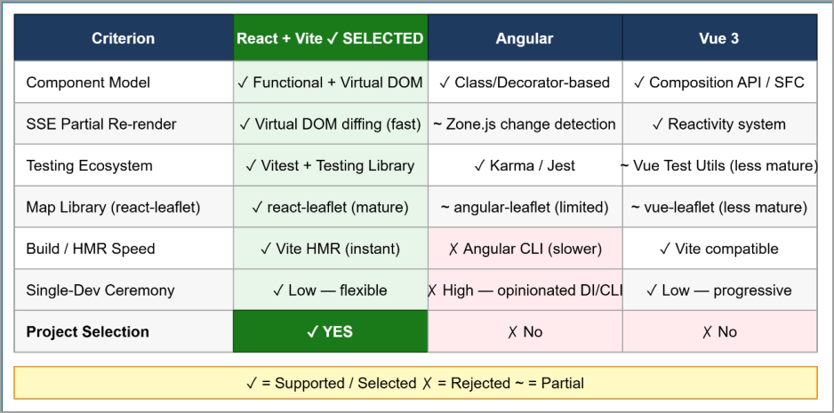


_Figure 1. Frontend technology comparison — React with Vite selected for SSE rendering efficiency, ecosystem maturity, and Vitest alignment._ 


#### **1.2.2 Backend Framework Comparison** 

Three backend options were looked at: Spring Boot with Java 17, Node.js with NestJS, and Python with FastAPI. The main features considered were type safety, how mature the security tooling was, database and transaction reliability, optimistic locking support, and how well each option fit the layered architecture pattern [4]. 

During my research, Spring Boot stood out as the right choice for this project [2, 9]. Java's static typing catches problems at compile time across the domain which covers users, bookings, parking spots, payments and transport data, giving a solid foundation before anything runs. Spring Security [15] handles JWT [29] authentication through a well-established filter chain that fits naturally with the stateless session approach used here. Besides, Spring Data JPA with Hibernate keeps database queries parameterised through typed repository interfaces, meaning user input is always treated as a value rather than being dropped directly into a query string, which rules out SQL injection by default [18]. 

The  @Transactional annotation ensures booking state changes either complete fully or not at all. The @Version annotation on the ParkingSpot entity also handles optimistic locking cleanly. If two users try to book the same spot at the same time, the first one through wins and the second gets an HTTP 409 Conflict response back, preventing double bookings without needing to hold a lock on the database row the entire time [16]. 

Node.js with NestJS was ruled out because TypeScript's type checking only applies during development and doesn't carry through at runtime, which is a real concern when money is involved, and data needs to stay accurate. It also doesn't have a built-in equivalent to JPA's optimistic locking, so that would have needed to be written manually, adding both time and the chance of getting concurrency wrong. Python with FastAPI didn't make the cut either, mainly because its transaction handling isn't as solid and it doesn't map as naturally onto the Controller-ServiceRepository pattern [4] that the test suite for this project was built around. 


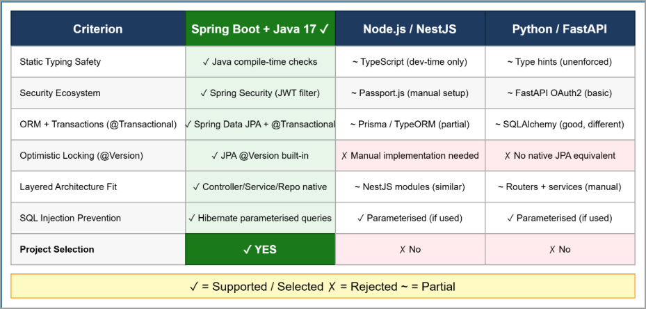


_Figure 2. Backend technology comparison — Spring Boot selected for type safety, security ecosystem depth, and native JPA optimistic locking._ 


#### **1.2.3 Database Comparison** 

PostgreSQL was chosen over MySQL and MongoDB, and the reasoning behind that comes down to how the data in this project is actually structured. Users make bookings, bookings point to parking spots, payments link back to bookings, and accessibility preferences tie to users. These relationships are fixed and well defined, so there was no real benefit to using something like MongoDB which is designed for situations where your data structure is flexible or unpredictable. That flexibility would have been wasted here. 

PostgreSQL handles all of this really well. It gives you full ACID compliance, meaning transactions are atomic, consistent, isolated, and durable, which matters a lot when you're dealing with payments and booking state changes that need to succeed or fail together. The foreign key enforcement with ON DELETE CASCADE keeps the data clean, and it works smoothly with Spring Data JPA [26]. One of the more important things it enabled was the @Version column on the parking spots and bookings tables, which is what powers the optimistic locking. Without that, two users trying to book the same last available spot at the same time could both succeed, which is exactly the double-booking problem the system is trying to avoid. PostgreSQL also supports more advanced indexing options which will help as the booking history and parking inventory tables get larger over time. 

Additionally, MySQL was considered since it is a perfectly reasonable relational database, but in its default configuration it has weaker constraint enforcement, less expressive index types, and historically has been a bit behind on some JPA features that this project relies on. For a system where referential integrity and optimistic locking are important, PostgreSQL just fits better. 

MongoDB was ruled out for a few reasons. The document-oriented approach it offers is genuinely useful when your data structure is loose or evolving, but that is not the case here. On top of that, MongoDB does not offer the same level of transactional guarantees that PostgreSQL does, which is a real concern when a payment record and a booking status update need to happen atomically. Spring Data MongoDB also does not have as mature an equivalent to the @Version based optimistic locking that Spring Data JPA provides, so it would have created extra complexity without solving any actual problem the project had. 

### **1.3 Architectural Paradigms and Design Patterns** 

#### **1.3.1 Architectural Paradigms** 

Three architectural approaches were looked at before deciding on one. 

N-tier layered architecture [4] was chosen because it was the most practically justified fit for this project's structure, consistent with Fowler's (2002) argument that layered systems enforce separation of concerns in a way that makes each layer independently testable and replaceable — a property that proved directly valuable when adding the admin dashboard in Term 2 without modifying any existing controller or service class. It splits the application into layers where each one has a specific job. The controller layer deals with incoming HTTP requests and maps them to responses. The service layer is where business logic lives, features like validating a booking or processing a payment. I designed the repository layer to handle all database communication through typed JPA interfaces, keeping data access cleanly separated from everything else. The 


model and DTO layer defines what the data looks like internally and what gets sent back through the API. I went with this structure because it makes everything traceable, you can follow any feature from a user story straight through to an endpoint, a service method, a repository query, and a test. Spring's dependency injection also keeps things honest because a controller cannot bypass the service layer and go straight to the database. This has also enabled me to make the testing significantly easier and stops business logic from ending up somewhere it should not be. 

The client-server pattern is naturally present since the React frontend and Spring Boot backend communicate through standard HTTP request-response cycles. JWT authentication keeps this stateless, meaning the server does not hold onto session information between requests. This was used as the communication foundation rather than a design strategy for how the backend is organised internally, since on its own it does not say much about how responsibilities should be split. 

Microservices were also considered but ruled out early on. The idea would have been to split pages like authentication, parking, payments, transport, and rides into their own separately deployed services, but doing that brings in a lot of extra problems that had nothing to do with what this project was actually trying to achieve. Beyond service discovery, inter-service authentication, distributed tracing, and keeping API contracts consistent across services would have taken up a huge amount of time and knocked me off the timeline I had laid out in my Gantt chart from Term 1. The layered monolith was a much better fit because it keeps things organised through the service layer without all that overhead. It is worth saying though that if the system ever needs to scale to a point where breaking it apart makes sense, the internal structure already supports that kind of transition down the line. 


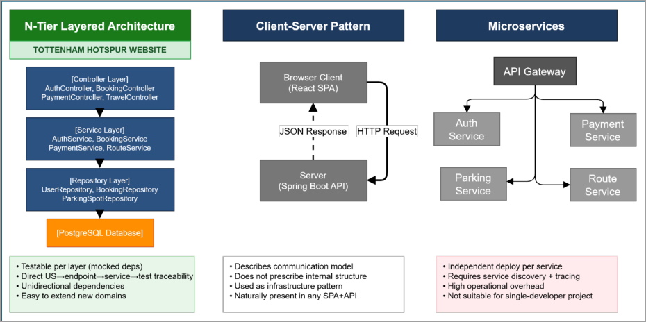


_Figure 3. Architectural paradigm comparison — N-tier layered architecture selected for traceability, testability, and single-developer suitability._ 

#### **1.3.2 Design Patterns Applied** 

Six design patterns were applied throughout the codebase, each chosen to solve a specific engineering problem rather than just to tick a box. 


- The **Repository pattern** is used through UserRepository, BookingRepository, and ParkingSpotRepository, all of which extend JpaRepository [26]. The reason for this is that it isolates all persistence logic behind typed interfaces, which makes unit testing much cleaner since service tests can swap in Mockito mock repositories without needing a real database connection. 

- The **Service Layer** pattern keeps the controllers thin and focused on HTTP concerns only. BookingService handles booking lifecycle state transitions, PaymentService wraps the Square SDK calls [20], and RouteService contains the Dijkstra computation [1]. Keeping business logic out of controllers means it can be tested independently and is not tied to the HTTP layer. 

- The **DTO pattern** is applied through classes like RegisterRequest, LoginRequest, PaymentRequest, and JourneyPlanResponse. These decouple what the API exposes from what the internal entity structure looks like, so if the database schema changes it does not automatically break the frontend contract. 

- **Controller Advice** is handled through a GlobalExceptionHandler class annotated with @ControllerAdvice, which centralises all exception to HTTP status mapping in one place. UserAlreadyExistsException maps to 409, UserNotFoundException to 404, InvalidCredentialsException to 401, and OptimisticLockException to 409 Conflict. Without this, the same error handling logic would have been duplicated across every controller. 

- The **Observer pattern** drives the real-time parking updates. ParkingAvailabilityPublisher acts as the subject and each SseEmitter registered by a connected client acts as an observer. When a spot changes state, the publisher calls emitter.send on every registered emitter, pushing the update to all connected browsers simultaneously. 

- The **Context Provider** pattern is used on the frontend through AccessibilityContext, which uses React's context API to make accessibility preferences available to every component in the tree without passing props through every level. When a preference changes. it applies CSS custom property updates directly to the document root, so the visual effect is immediate and consistent across the whole interface. 


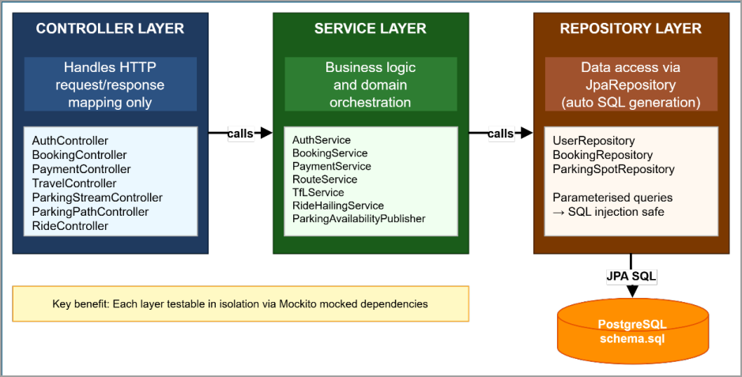


_Figure 4. The Controller-Service-Repository pattern as implemented in the Spring Boot backend with real class names from the codebase._ 


### **1.4 Security and Privacy** 

#### **1.4.1 Authentication and JWT** 

All user passwords are hashed using BCryptPasswordEncoder before storage, a decision aligned with OWASP's password storage guidance which recommends adaptive hashing functions precisely because their configurable cost parameter ensures that increasing hardware capacity does not proportionally reduce an attacker's brute-force cost — a property that plain SHA-256 hashing does not provide [28]. 

BCrypt incorporates a configurable work factor (cost parameter) that is computationally expensive by design, meaning that increasing server hardware capacity does not proportionally reduce an attacker's cost to brute-force a hash — the work factor can be increased over time to maintain security as hardware improves. Moreover, the application never stores, logs, or transmits plaintext passwords at any point in the authentication flow. The OWASP guidance [28] recommends BCrypt, Argon2, or scrypt for password storage; BCrypt was selected for its mature Spring Security [15] integration. 

On successful authentication, JwtUtil.generateAccessToken() creates a signed HS256 JSON Web Token [29] with the user's userId as the subject and a configurable expiry duration. Importantly, the subject is the userId (a Long identifier) rather than the email address, following the principle that JWT subjects should be opaque identifiers rather than personally identifiable information. All subsequent requests must include this token as a Bearer value in the Authorization header. By using the Spring Security filter chain, this intercepts each request before any controller executes. Also, this extracts the Bearer token, calls validateToken(token, subject), and returns HTTP 401 Unauthorized immediately if the token is absent, malformed, or expired. I have chosen this due to its stateless model [2] which would mean no server-side session table or distributed session cache is required, making the backend horizontally scalable from the outset. 

`// JwtUtil.java — generateAccessToken and validateToken public String generateAccessToken(String subject) { return Jwts.builder() .setSubject(subject)         // userId, not email .setIssuedAt(new Date()) .setExpiration(new Date(System.currentTimeMillis() + accessTokenExpiration)) .signWith(key, SignatureAlgorithm.HS256) .compact(); } public boolean validateToken(String token, String subject) { try { Claims claims = extractClaims(token); return claims.getSubject().equals(subject) && claims.getExpiration().after(new Date()); } catch (ExpiredJwtException ex) { return false; } }` _Code Snippet 1. JwtUtil.java — HS256 token generation using userId as subject, and expiry-aware validation used by the Spring Security filter chain._ 


#### **1.4.2 SQL Injection, XSS, and CORS** 

SQL injection is prevented by how the data access layer is built rather than through manual input checking. All database interactions go through typed JpaRepository interfaces or explicit JPQL named queries, which means Hibernate handles query generation using PreparedStatement abstractions. User supplied values are always bound as typed parameters, never concatenated directly into SQL strings. This matters because it removes the injection vector at the source rather than relying on sanitisation rules that can be missed or bypassed [26]. 

Cross-site scripting risk is reduced by how React handles dynamic content by default. When React renders a string value inside a JSX expression it HTML-encodes the output automatically, so malicious script content in user data does not get executed in the browser. Form inputs are managed through React state using controlled components rather than direct DOM property access like innerHTML, which keeps input handling predictable and safe [23]. 

CORS is configured in CorsConfig to only allow cross-origin requests from the authorised frontend origin, which in development is localhost:5173. This means requests from unauthorised third-party domains cannot include credentials or interact with the API, closing off a common vector for crossorigin attacks. The configuration was kept deliberately tight because opening CORS too broadly would undermine the authentication model the rest of the system depends on. 

```
// SecurityConfig.java — stateless JWT filter chain with explicit permit
rules
@Bean
public SecurityFilterChain filterChain(HttpSecurity http) throws
Exception {
    http
        .csrf(csrf -> csrf
.csrfTokenRepository(CookieCsrfTokenRepository.withHttpOnlyFalse())
            .ignoringRequestMatchers("/auth/**", "/api/auth/**",
"/api/**"))
        .authorizeHttpRequests(auth -> auth
            .requestMatchers("/auth/**", "/api/auth/**",
                             "/api/travel/**", "/api/trains/**",
                             "/api/rides/**").permitAll()
            .anyRequest().authenticated())
        .sessionManagement(session ->
```

```
session.sessionCreationPolicy(SessionCreationPolicy.STATELESS));
    return http.build();
}
```

_Code Snippet 2. SecurityConfig.java — stateless session policy, JWT filter chain, and explicit public endpoint permissions for transport data routes._ 

#### **1.4.3 Payment Security and PCI-DSS** 

Payment card data is handled entirely through the Square Web SDK [20], which injects a sandboxed iframe into the frontend checkout form. Card numbers, expiry dates, and CVV values entered by the user are captured and tokenised by Square's servers, returning a single-use nonce 


(called sourceId in the codebase). Only this nonce and the amount in pence are sent from the React frontend to POST /payments. 

Moreover, PaymentService uses this nonce to construct a CreatePaymentRequest with a UUIDbased idempotency key — ensuring that network-level retries cannot result in duplicate charges — and executes the charge through the Square Java SDK. Raw Primary Account Numbers never pass through the Spring Boot server, its logs, or the PostgreSQL database. This approach was adopted because its tokenisation model aligns with PCI-DSS compliance requirements while significantly reducing the system’s security exposure [20]. 

#### **1.4.4 Privacy and GDPR** 

The system stores personal data across various tables in the PostgreSQL schema: 

- User accounts (email, BCrypt-hashed password, name, last login timestamp) 

- Booking history (user_id FK, spot_id FK, times, status) 

- Payment records (booking_id FK, amount in pence, Square nonce for audit, payment status, timestamp) 

- Accessibility preferences (user_id FK, five boolean/integer preferences). 

Data minimisation principles were applied throughout the system. No location tracking, behavioural analytics, or data enrichment beyond what the application needs to function was included, because collecting data that serves no operational purpose only introduces unnecessary risk. I implemented the ON DELETE CASCADE constraint on the user_id foreign key across the bookings, payments, and accessibility preferences tables ensures that deleting an account automatically removes all associated records. 

This design supports a right-to-erasure pattern by ensuring that all dependent records are automatically removed upon user deletion that aligns with GDPR Article 17, giving users a clean exit from the system rather than leaving orphaned data behind. Full GDPR compliance, covering things like lawful basis documentation, data subject access request workflows, and a data protection impact assessment, falls outside my academic scope but is explicitly identified as a requirement before any production deployment. 


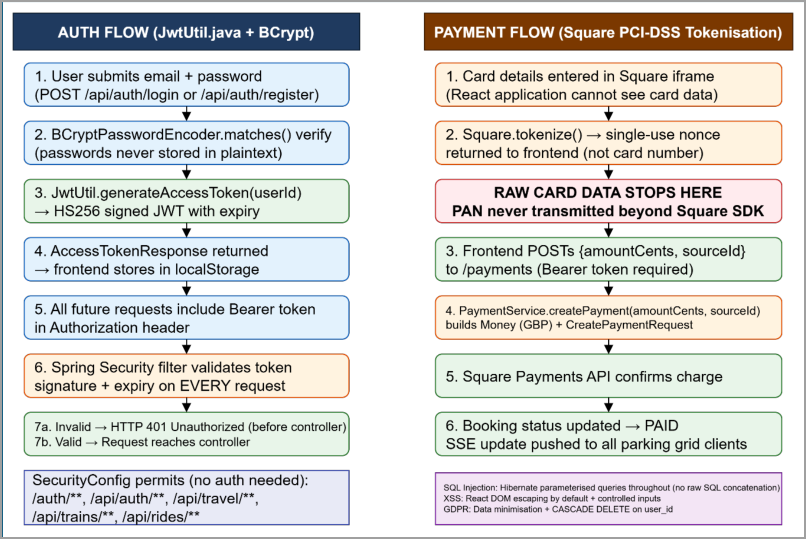


_Figure 5. Authentication and payment security flows showing sensitive data boundaries at every stage._ 

### **1.5 Web Technologies and Early Deliverables** 

Development was structured so that the foundations were in place before any higher level features were added. This approach was taken to ensure that foundational infrastructure was validated early, reducing the likelihood of compounding issues later in development. 

The Spring Boot project was set up using Spring Initializr with Spring Web, Spring Data JPA, Spring Security, and the PostgreSQL driver as the core dependencies. The Square Java SDK [20], JJWT for JWT handling [29], and JaCoCo were added to pom.xml straight away rather than being retrofitted later. I did it this way because adding dependencies midway through development can break things that were already working, so getting them in early meant the project was building on a stable base from the start. Furthermore, the PostgreSQL database schema was written in schema.sql and initialised on application startup, with all five core tables created including their constraints, foreign keys, version columns for optimistic locking, and indexes [26]. Writing this explicitly rather than relying on Hibernate's auto-generation was a deliberate choice because it kept every SQL construct visible and reviewable, which made the database structure much easier to reason about and change safely as development progressed. 

On the frontend, the React project was set up with Vite and the React template, with React Router, Vitest, and Testing Library added to the configuration straight away [23][24]. One early decision that paid off throughout the project was writing the api.js utility module before any feature pages were built. This centralises token management, base URL construction, authentication header formatting, and error handling in one place. Doing this early meant every page talked to the backend in a consistent way from the beginning, rather than ending up with different pages handling API calls slightly differently, which would have made testing and maintenance much messier down the line. 

Moreover, the first complete vertical slice built was user registration, login, JWT issuance, and an authenticated GET request to the bookings endpoint. This was fully validated before any other feature work started, because this one slice touched every layer of the system. Getting this working first meant that CORS configuration, JWT filter ordering, and React Router navigation were all 


confirmed to be correctly integrated before anything else was built on top of them. This sequencing reduced early-stage uncertainty and enabled a more stable and predictable development process. 

### **1.6 Literature Review: Comparable Systems** 

#### **1.6.1 Journey Planning Platforms** 

Citymapper, Google Maps, and the TfL Journey Planner provide multi-modal route computation with real-time disruption awareness. Citymapper offers well-designed London-specific line status indicators with disruption severity colour coding and supports accessible routing for step-free journeys where TfL data [21] is available. 

Google Maps offers the broadest geographic coverage and can piece together multi-modal journeys across different transport types. The TfL Journey Planner is the most reliable source for London transit information since it pulls directly from TfL's own operational systems [21]. Both platforms are strong when it comes to routing intelligence and keeping data fresh in real time. 

Where they fall short in a matchday stadium context is that none of them offer any kind of transactional capability tied to the event. A Citymapper user can check that the Victoria line is running normally but cannot reserve a parking space or pay for it within the same workflow. Transport planning and parking reservation are treated as separate concerns, which means users must switch between applications to complete what is really one connected journey decision. That is exactly the fragmentation problem this project was built to solve. This fragmentation problem is consistent with findings in the broader literature on multi-modal journey planning. Bast et al. (2016) identify the absence of unified transactional capability as a fundamental limitation of existing journey planning systems [17], noting that route computation and reservation systems have historically been developed in isolation rather than as integrated pipelines. My project directly addresses this gap by combining route computation, real-time availability data, and payment processing within a single coherent workflow. 

However, none of these platforms offer ride fallback options within the same interface, and none of them carry accessibility preferences across journey planning sessions, so users with specific needs have to reconfigure their settings every time they start fresh in a different app. 

#### **1.6.2 Parking Reservation Platforms** 

JustPark, ParkingEye, and RingGo all cover slot discovery, reservation, and payment for parking. JustPark in particular handles event parking well, especially near major UK venues, and has a clean booking flow with clear slot status and mobile payment built in [20]. ParkingEye takes a different approach, focusing on automated number plate recognition at managed car parks [20]. Where these platforms are strong is in the parking transaction itself — finding a space, reserving it, and paying for it is handled smoothly within each app. 

Moreover, the problem in a matchday context is that they have no awareness of transport at all. A fan who completes a JustPark booking has no way of knowing within that same app whether their planned route to the car park is still viable if a TfL disruption happens after payment has gone through [21]. There is nothing to prompt the user to consider ride alternatives if a line suspension suddenly makes driving the only realistic option. The parking decision and the transport decision live in completely separate information environments, so every time something changes the fan has 


to manually switch between apps to reassess their plan. That kind of reactive switching is exactly what creates stress on matchday when time is short and conditions are changing quickly. 

Real-time slot availability in JustPark is also typically polled rather than pushed, an architectural limitation that Fielding (2000) identifies as a fundamental constraint of request-response communication models [16] — the status a user sees may be several seconds or minutes behind ground truth, which under peak matchday demand creates a meaningful window in which doublebooking becomes possible. During peak demand before kick-off, that lag matters because a space that appears available may already be taken by the time the booking goes through. 

#### **1.6.3 Ride-Hailing Platforms** 

Uber and Bolt both do real-time driver availability, surge pricing transparency, and ETA estimation well, and the mobile experience on both is strong. In a matchday context their main value is as a fallback option when rail or tube disruption makes public transit impractical, which is particularly relevant given that around 30% of Tottenham Hotspur Stadium visitors arrive by methods other than walking or cycling [21]. 

Where they fall short is that their scope is very narrow. They only address the final leg of the journey from wherever the user currently is to the stadium. They offer nothing on parking, nothing on transport network status further up the route, no journey planning from a home origin, and no accessibility aware options. Uber and Bolt also have no connection to any parking system, so a user who has already made a JustPark booking and then switches to Uber to sort out a disrupted journey has effectively abandoned their parking context entirely and has to manage both situations separately. This limitation is addressed through integration with the Cabwise API, providing fallback ride options within the same workflow. This integration pulls in nearby ride options within the same workflow the user is already in, so they do not have to leave the planning context to find an alternative. I have chosen this because the explicit fallback behavior also means that if the Cabwise API is unavailable, the page still returns useful options rather than leaving the user with nothing, which in a time pressured matchday situation makes a real difference. 


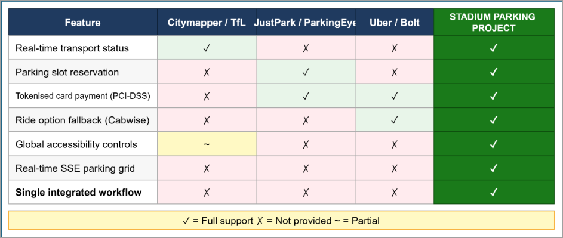


_Figure 6. Feature comparison between this project and comparable existing systems — integration across all domains is the primary contribution._ 


### **1.7 Features Delivered, Limitations, and Planned Improvements** 

#### **1.7.1 Features Delivered** 

The following features were fully implemented: 

- JWT authentication with BCrypt hashing handles login and registration using email and password credentials. 

- The real-time parking slot grid is driven by Server-Sent Events from the GET /spots/stream endpoint, with JPA optimistic locking in place to prevent double-booking when multiple users attempt to reserve the same slot simultaneously. 

- Squares tokenised card payment is integrated through POST /payments, covering success, failure, and refund paths so that the full transaction lifecycle is handled. 

- Moreover, TfL transport status and journey planning is available through TfLService, including disambiguation handling for ambiguous station name queries. Ride options are retrieved via GET /api/rides/live through the Cabwise API, with a sample fallback card set shown when the live API is unavailable. 

- Advanced Pathfinding including Dijkstra which is the shortest-path route computation is exposed via GET /api/travel/route, and A* parking pathfinding using a Manhattan heuristic is available via GET /api/parking/path. 

- Admin Dashboard that can examine comprehensive transaction data and control parking inventory status (such as shutting sections) through a secure, role-based portal. 

- Global accessibility controls covering font size, high contrast, screen reader mode, reduced motion, and step-free preference are managed through a persistent AccessibilityContext in line with WCAG 2.1. 

- Production Deployment using Docker and deployed to a cloud hosting provider in order to move beyond the local development environment (localhost). 

- A keyword-driven chat assistant with quick navigation links is also included, alongside comprehensive backend test suites using JUnit 5, Mockito, and JaCoCo, and frontend test suites using Vitest, Testing Library, and V8. 

#### **1.7.2 Known Limitations** 

Several limitations should be acknowledged to accurately evaluate the system’s current state.. The Dijkstra route graph runs on a predefined demonstration topology, so while the algorithm itself is correctly implemented and produces accurate shortest path results, the graph nodes do not reflect real North London transport interchange distances and connections. 

Likewise, the same applies to the A* implementation, which uses a controlled 3x3 demo grid rather than an actual stadium car park layout. The heuristic and search logic are correct and provably optimal for this grid, but the practical usefulness of the output is limited by how simple the topology is. 

After rigorous testing I have found out that there is no refresh token endpoint, which means users have to re-authenticate once their JWT access token expires and that Password reset and account recovery flows were not implemented within the project timeline. 

The SecurityConfig CSRF configuration currently uses ignoringRequestMatchers on /api/** which is broader than it needs to be and is a known technical debt item that would need tightening before any production deployment. 

Finally, the Load testing under realistic stadium-scale concurrent booking traffic has not been carried out, so while the optimistic locking and SSE architecture provide correctness guarantees, the actual performance bounds under heavy load have not been measured. 


#### **1.7.3  Planned Improvements** 

In the future the most impactful improvement would be replacing the demonstration route graphs with real geospatial data from OpenRouteService, which would make the Dijkstra route recommendations genuinely useful for real journeys rather than just demonstrating the algorithm. A refresh token rotation endpoint with explicit revocation would remove the need for users to reauthenticate when their token expires. 

Password reset and account recovery flows would also be added, along with a tighter CSRF configuration using specific endpoint matchers. Playwright or Cypress end-to-end browser tests would be introduced to validate complete user journeys on a deployed instance rather than relying solely on unit and component level tests. 

In the long run there are several directions I would like to take this project if it were to grow beyond academic scope. The payment domain is a natural candidate for extraction into its own independently deployable microservice, but only once the scale genuinely justifies that complexity rather than doing it for the sake of it. A native iOS and Android application built with React Native would make the platform far more accessible to matchday visitors who are on the move and relying on their phones, which realistically is most of them. 

Push notifications for departure reminders and booking confirmations would also add real practical value, since a fan who booked parking two hours before kick-off benefits from a timely reminder rather than having to remember to check the app themselves. On the accessibility side I would want to go further than the current controls by introducing a simplified language mode and dyslexia friendly font options, because the current implementation covers visual preferences well but cognitive accessibility is an area that deserves more attention. 


## Chapter 2: **Web Application Features and User Stories** 

### **2.1 Feature Domains** 

The application is built around eight integrated feature domains that together form one continuous matchday decision workflow rather than a collection of isolated screens. 

- **Authentication** handles secure registration and login using email and password credentials, JWT session persistence in localStorage through saveAuthData(), and protected API access using Bearer token headers built by getAuthHeaders(). Every account dependent feature in the application relies on this domain working correctly, which is why it was treated as the highest priority integration from the start. 

- **Parking Visibility and Booking** drives the real-time slot grid through Server-Sent Events from GET /spots/stream, allowing users to filter slots by status and find available spaces quickly. Booking creation uses @Transactional and @Version optimistic locking to prevent double-booking when multiple users try to claim the same slot at the same time. 

- **Payment Processing** uses the Square Web SDK iframe tokenisation approach so raw card details never touch the application server. Payments go through POST /payments with an amountCents and sourceId payload, and POST /payments/{id}/refund handles cancellations. 

- **Route and Journey Planning** combines Dijkstra shortest-path computation via GET /api/travel/route, TfL journey planning via GET /api/travel/plan with station disambiguation handling for ambiguous inputs, and live train service data via GET /api/trains/live. 

- **Live Status and Map** pulls TfL line status through TrainService and TfLService and conditionally renders a react-leaflet map centred on White Hart Lane, giving users a visual picture of what is happening around the stadium. 

- **Ride Options** retrieves nearby ride choices via GET /api/rides/live through the Cabwise API, with normalised sample fallback cards shown automatically when the live API is unavailable so the page always returns something useful. 

- **Accessibility** is managed through a globally persistent AccessibilityContext covering font size, high contrast mode, screen reader support, reduced motion, and step-free preference, all of which persist across page navigation rather than resetting when the user moves between screens. 

- **Chat Assistant** provides a keyword-driven interface with prompt starters and quick navigation links to help users find the right part of the application without having to explore manually. 

### **2.2 User Stories** 

Table 2.1 presents all 22 user stories with actor, need, priority, and completion status. Priority was assigned based on how critical each feature is to the core user journey, with High priority given to anything on the main transactional path and medium priority given to resilience and supporting features. 

The reason for covering all 22 rather than a smaller subset comes down to how the application is structured. With eight feature domains and multiple distinct user facing behaviours within each 


one, collapsing them into fewer stories would have meant losing the granularity needed to write meaningful acceptance criteria. Each story represents a behaviour that a user can actually observe and interact with, so keeping them separate made testing and validation much more straightforward. 

|**ID**|**Actor**|**Need**|**Priority**|**Status**|
|---|---|---|---|---|
|**US-**<br>**01**|New User|**Register**As a new visitor to the platform, I want<br>to register with my name, email, and password<br>so that I can create a personal account and access<br>booking features that require authentication.|**High**|**Done**|
|**US-**<br>**02**|Returning<br>User|**Login**As a returning user, I want to log in with<br>my email and password so that I can access my<br>account securely, with a clear and specific error<br>message shown if my credentials are incorrect<br>rather than a generic failure response.|**High**|**Done**|
|**US-**<br>**03**|Logged-in<br>User|**Session Persistence**As a logged-in user, I want<br>my session to persist across page navigation<br>without being asked to re-authenticate, so that I<br>can move between the booking, transport, and<br>payment pages without interruption to my<br>workflow.|**Medium**|**Done**|
|**US-**<br>**04**|Driver|**Parking Grid**As a driver planning matchday<br>parking, I want to browse the full parking grid<br>with colour-coded slot availability, green for<br>available, red for occupied, and grey for<br>reserved, so that I can quickly assess the overall<br>parking situation at a glance before making a<br>selection.|**High**|**Done**|
|**US-**<br>**05**|Driver|**Slot Filtering**As a user browsing the parking<br>grid, I want to filter slots by status including all,<br>available, occupied, or reserved, so that I can<br>narrow down my options without having to scan<br>the entire grid manually during a busy matchday<br>period.|**High**|**Done**|
|**US-**<br>**06**|Driver|**Blocked Slots**As a user attempting to book<br>parking, I want occupied slots to be visually<br>blocked and unclickable so that I cannot<br>accidentally attempt to book a space that is<br>already taken, preventing failed payments and<br>wasted time.|**High**|**Done**|


|**ID**|**Actor**|**Need**|**Priority**|**Status**|
|---|---|---|---|---|
|**US-**<br>**07**|Driver|**Slot Selection**As a user choosing a parking<br>space, I want to select an available slot and<br>receive immediate visual confirmation of my<br>selection so that I know my choice has been<br>registered before proceeding to payment.|**High**|**Done**|
|**US-**<br>**08**|Fan|**Payment**As a user completing a parking<br>reservation, I want to pay using a tokenised card<br>payment through the Square Web SDK so that<br>my card details are never sent directly to the<br>application server and my payment is handled<br>securely.|**High**|**Done**|
|**US-**<br>**09**|Fan|**Payment Feedback**As a user who has<br>submitted a payment, I want to receive clear<br>success or failure feedback after every payment<br>attempt so that I always know whether my<br>booking has been confirmed or whether I need to<br>try again.|**High**|**Done**|
|**US-**<br>**10**|Fan|**Refund**As a user with a cancelled or failed<br>booking, I want to request a refund through a<br>dedicated endpoint so that I am not left out of<br>pocket when a transaction does not result in a<br>confirmed reservation.|**Medium**|**Partial**|
|**US-**<br>**11**|Commuter|**Transport Status**As a matchday visitor<br>planning my journey, I want to view live TfL<br>transport line status so that I can adapt my travel<br>plan before leaving home if there are delays or<br>suspensions on my intended route.|**High**|**Done**|
|**US-**<br>**12**|Commuter|**Journey Planning**As a user planning my route<br>to the stadium, I want to plan a journey between<br>an origin and destination using the Dijkstra route<br>planner so that I can get a recommended path<br>with estimated cost and travel nodes.|**High**|**Done**|
|**US-**<br>**13**|Commuter|**Disambiguation**As a user entering a station<br>name into the journey planner, I want to receive<br>selectable disambiguation options when my<br>input matches multiple TfL results so that I can<br>confirm the correct station rather than receiving<br>an incorrect or failed route response.|**Medium**|**Done**|


|**ID**|**Actor**|**Need**|**Priority**|**Status**|
|---|---|---|---|---|
|**US-**<br>**14**|Commuter|**Route Details**As a user comparing journey<br>options, I want to view route nodes, estimated<br>duration, and cost so that I have enough detail to<br>make an informed decision about which route<br>suits my matchday travel plan.|**High**|**Done**|
|**US-**<br>**15**|Fan|**Ride Options**As a matchday visitor whose<br>transit route has been disrupted, I want to view<br>nearby ride options via the Cabwise API so that I<br>have a practical fallback travel choice available<br>without leaving the application.|**Medium**|**Partial**|
|**US-**<br>**16**|Fan|**Ride Fallback**As a user on the ride options<br>page when the live Cabwise API is unavailable, I<br>want to see labelled sample fallback cards so that<br>the page remains useful and I am not left with an<br>empty screen during a critical planning moment.|**Medium**|**Partial**|
|**US-**<br>**17**|Visual user|**Font Size**As a user with visual preferences, I<br>want to adjust the global font size between 12<br>and 28 pixels across the entire application so that<br>text remains comfortably readable for me<br>regardless of which page I am on.|**High**|**Done**|
|**US-**<br>**18**|Contrast user|**High Contrast**As a user with contrast<br>sensitivity requirements, I want to enable high-<br>contrast mode so that interface elements remain<br>clearly legible and I can use the application<br>without straining to read low-contrast text or UI<br>components.|**High**|**Done**|
|**US-**<br>**19**|Motion user|**Reduced Motion**As a user sensitive to<br>animations, I want to activate reduced-motion<br>mode so that transitions and movement effects<br>are minimised and the interface remains<br>comfortable to use throughout my session.|**Medium**|**Done**|
|**US-**<br>**20**|Mobility<br>user|**Step-Free Preference**As a user with mobility<br>requirements, I want to set a step-free travel<br>preference so that TfL journey planning takes<br>my accessibility needs into account when<br>suggesting routes to and from the stadium.|**High**|**Done**|


|**ID**|**Actor**|**Need**|**Priority**|**Status**|
|---|---|---|---|---|
|**US-**<br>**21**|All Users|**Chat Assistant**As a user who is unsure where to<br>find a specific feature, I want to use a keyword-<br>driven chat assistant with prompt starters and<br>quick navigation links so that I can be directed to<br>the right page quickly without having to explore<br>the application manually.|**Medium**|**Done**|
|**US-**<br>**22**|Developer|**Setup Documentation**As a developer or<br>assessor running the project locally, I want<br>access to clear setup and run documentation so<br>that I can get the application running in a<br>reproducible<br>way<br>without<br>needing<br>prior<br>knowledge<br>of<br>the<br>specific<br>environment<br>configuration.|**High**|**Done**|


_Table 1. Complete user story set — 22 stories covering all 8 feature domains with actor, priority, and status._ 

#### **2.2.1 Prioritisation Rationale** 

US-01 and US-02 are High priority because authentication gates every account-dependent feature. Without a working login, booking, payment, and transport planning are all inaccessible, making auth a direct dependency for the majority of the remaining stories. Moreover, US-04 to US-09 are High because they deliver the core transactional value the project was built around. 

Without parking and payment working, the application is just a transport dashboard rather than an integrated assistant. US-11 to US-14 are High because transport planning is what differentiates this platform from a standard parking app. In addition, the accessibility stories US-17, US-18, and US20 are High because WCAG 2.1 treats inclusive design as an engineering requirement, not an optional addition. 

### **2.3 Requirements Analysis Process** 

Requirements came from mapping the full matchday user journey from start to finish rather than just listing features. At each step the question was what the system needs to give the user here, and what happens if that information is missing or wrong. Asking it that way meant fallback behaviour like the Cabwise fallback and TfL disambiguation came up naturally as requirements rather than being tacked on later. 

Three things shaped what made it into scope. First, how critical the feature was to the core journey. Second, dependency order, auth had to work before booking could be built, and booking had to work before payment made sense to tackle. Third, API risk, the Cabwise integration was left until later with a fallback in place because the response structure turned out to be inconsistent, whereas TfL disambiguation was handled from day one because ambiguous station names are something 


you can predict will happen rather than a rare edge case. Thinking about it this way kept the work ordered and stopped less important features from eating into time that needed to go on the core ones. 

Features that did not make it into scope, cloud deployment, mobile apps, microservices, load testing, email notifications, and full GDPR governance, were all conscious decisions given the timeline and the fact this was a solo project. Each one is listed as a future improvement in Section 1.7.3 so it is clear they were ruled out deliberately rather than missed. 


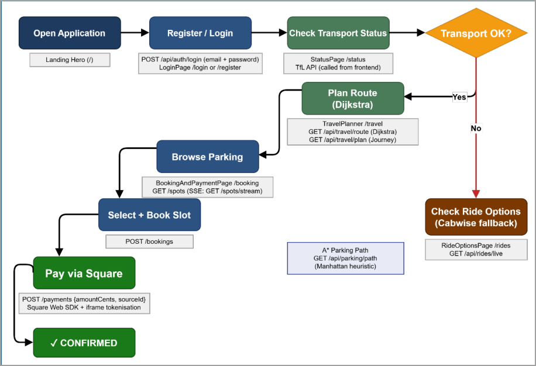


_Figure 7. Complete matchday user journey showing how all eight feature domains connect into one coherent decision workflow_ 

### **2.4 Non-Functional Requirements** 

|**Attribute**|**Requirement and Implementation**|
|---|---|
|**Security**|All passwords are hashed with BCrypt and JWT HS256 handles stateless<br>authentication. Square iframe tokenisation means raw card data never reaches<br>the server, Hibernate parameterised queries prevent SQL injection, and CORS<br>is restricted to the authorised frontend origin.|
|**Accessibility**|Accessibility<br>preferences<br>are<br>managed through a persistent global<br>AccessibilityContext covering font size between 12 and 28 pixels, high<br>contrast, reduced motion, screen reader, and step-free preference, with ARIA|


|**Attribute**|**Requirement and Implementation**|
|---|---|
||labels on all interactive elements.|
|**Reliability**|Reliability is handled through graceful fallback for Cabwise API failures using<br>sample cards and a banner, a GlobalExceptionHandler that returns consistent<br>error payloads across all endpoints, and SSE emitter lifecycle management via<br>onCompletion and onTimeout handlers.|
|**Maintainability**|The backend follows a layered Controller, Service, and Repository structure,<br>the frontend uses a modular React component hierarchy with a shared api.js<br>utility, and accessibility state is centralised through AccessibilityContext.|
|**Testability**|Testing uses JUnit 5 and Mockito on the backend and Vitest with Testing<br>Library on the frontend, with JaCoCo for backend coverage and V8 for<br>frontend coverage. Dependencies are mocked at every layer to keep tests<br>isolated.|
|**Performance**|Both Dijkstra and A* run locally and return results in under 100ms. SSE<br>updates reach connected clients in around 500ms, and conditional map<br>mounting avoids unnecessary Leaflet initialisation on pages where the map is<br>not needed.|


_Table 2 Non-functional requirements with implementation approach and citations._ 

### **2.5 Accessibility Design Rationale** 

AccessibilityContext stores five preferences: fontSize clamped between 12 and 28px, highContrast, screenReader, reduceMotion, and stepFree. These persist to localStorage on every state change via a useEffect hook. Besides, a second useEffect propagates changes to the document through a CSS custom property update, body class toggles for high contrast, screen reader, and reduced motion, and a data attribute for step-free preference. 

> `// AccessibilityContext.jsx — localStorage persistence and global CSS side effects` 

> `useEffect(() => { localStorage.setItem(STORAGE_KEY, JSON.stringify(settings)); }, [settings]);` 

```
useEffect(() => {
```

```
  const size = Math.max(12, Math.min(28, settings.fontSize)); // bounded
12–28px
```

> `document.documentElement.style.setProperty("--app-font-size", `${size}px`); document.body.classList.toggle("a11y-high-contrast", settings.highContrast); document.body.classList.toggle("a11y-screen-reader", settings.screenReader);` 


```
  document.body.classList.toggle("a11y-reduce-motion",
settings.reduceMotion);
  document.body.setAttribute("data-step-free",
      settings.stepFree ? "true" : "false");
}, [settings]);
```

_Code Snippet 3 AccessibilityContext.jsx — localStorage persistence and global CSS custom property side effects propagating preferences across the full application._ 

This ensures that all components inherit accessibility preferences automatically without requiring per-component configuration without per-component overrides, and any new page added to the application gets full accessibility behaviour through React's context API without any additional work. 


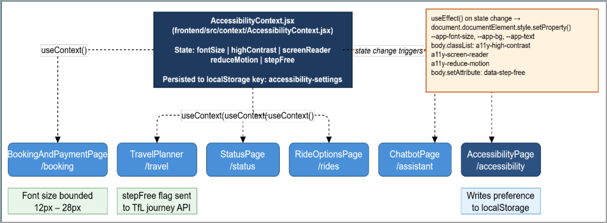


_Figure 8. AccessibilityContext propagation model — preferences flow from user toggle through localStorage, CSS properties, and TfL API parameters._ 

Finally, the implementation maps directly to WCAG 2.1 success criteria: SC 1.4.4 for text resizing, SC 1.4.11 for non-text contrast, SC 2.3.3 for reduced motion, and Guideline 1.3 for screen reader adaptability. I have chosen to do this objective as it its persistent cross-cutting preferences rather than per-page toggles which makes accessibility an architectural property of the whole interface rather than a feature bolted onto individual pages. 


## Chapter 3: **Implementation and Technical Realisation** 

This chapter walks through how each feature was built, covering the backend and frontend together so the full picture sits in one place rather than being split across separate sections. The code snippets, class names, endpoint paths, and data model details all come directly from the submitted codebase. 

### **3.1 Authentication and Account Management** 

AuthController handles registration and login and is mapped to two base paths, /auth and /api/auth. This dual mapping supports both direct API testing via Postman and frontend integration through the Vite development server without requiring separate CORS configurations. 

```
// AuthService.java — register (email-based, userId as JWT subject)
public AccessTokenResponse register(RegisterRequest request) {
    if (userRepository.existsByEmail(request.getEmail())) {
        throw new UserAlreadyExistsException(
            "A user with this email already exists.");
    }
    User user = new User();
    user.setEmail(request.getEmail());
    user.setPassword(passwordEncoder.encode(request.getPassword()));
    String[] names = splitName(request.getName());
    user.setFirstName(names[0].isBlank() ? request.getEmail() :
names[0]);
```

```
    user.setLastName(names[1]);
```

```
    User saved = userRepository.save(user);
    String token = jwtUtil.generateToken(saved.getUserId().toString());
    return new AccessTokenResponse(token);
 }
```

_Code Snippet 4 AuthService.java — registration using email (not username), BCrypt encoding, and userId-based JWT issuance._ 

When a user registers, I built the service to check whether the email is already in use before doing anything else. If it is, a 409 conflict response goes back to the client. If not, the password gets hashed with BCrypt, the user record is saved, and a JWT is issued using the userId as the subject. Login works similarly, the service finds the user by email, checks the password matches the stored hash, updates the last login timestamp for audit purposes, and returns a token. If the email does not exist the client gets a 404, and if the password is wrong it gets a 401, so there is never an ambiguous or unhandled error response. 


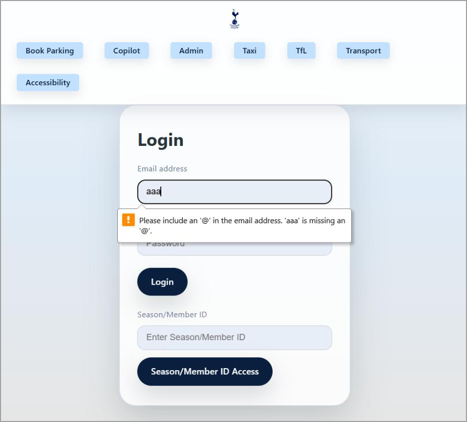


_Figure 9. Login page showing the email/password authentication form with inline error feedback on invalid credentials._ 

On the frontend, the login call sends the email and password to the API, checks the response for errors, and on success stores the token in localStorage. Every subsequent request that needs authentication pulls that token out and attaches it as a Bearer header automatically, so individual pages do not need to handle that themselves. 


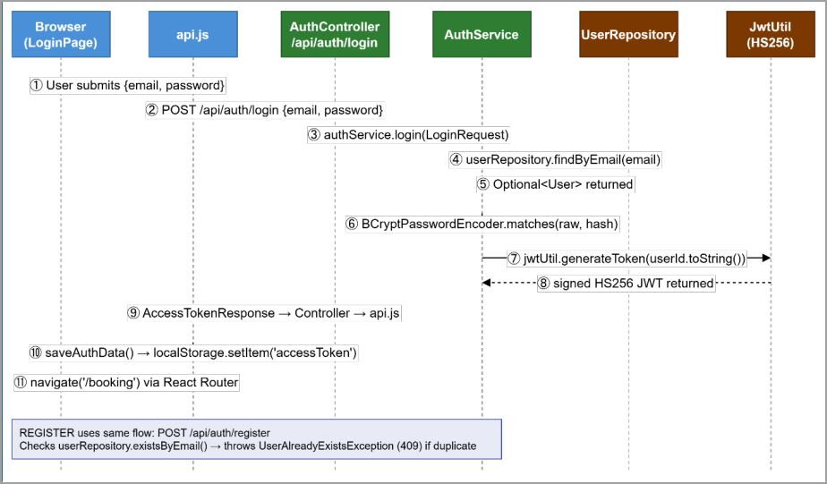


_Figure 10. Login and JWT issuance sequence using email credentials and userId as the token subject._ 

### **3.2 Real-Time Parking with SSE and Optimistic Locking** 

ParkingSpotController handles all the basic parking inventory operations—creating, listing, updating, and removing spots. The real-time side of things is handled by a separate SSE endpoint at GET /spots/stream. Server-Sent Events [SSE] were selected because the communication model is strictly unidirectional, making it more suitable than WebSocket. For this use case, the server pushes slot updates to the browser and the browser never needs to send anything back through the same connection. Besides that, SSE works over standard HTTP and is supported natively by the browser without needing any extra libraries, which kept things simpler on the frontend. 

On top of that, optimistic locking acts as a second layer of protection at the database level. If two users somehow manage to attempt booking the same slot at almost exactly the same time, only the first one to complete the transaction succeeds. The second gets a conflict response, and the frontend shows a clear message telling them the slot is no longer available so they can pick a different one. That said, in practice the SSE updates reduce the chances of that situation arising in the first place, and the optimistic locking is there to guarantee correctness on the rare occasions it does. 

```
// ParkingStreamController.java — SSE endpoint
@GetMapping("/spots/stream")
public SseEmitter streamSpots() {
    return publisher.subscribe();
}
// ParkingAvailabilityPublisher.java — lifecycle-managed emitter
collection
public SseEmitter subscribe() {
    SseEmitter emitter = new SseEmitter(Long.MAX_VALUE);
    emitters.add(emitter);
    emitter.onCompletion(() -> emitters.remove(emitter)); // client
disconnect
    emitter.onTimeout(() -> emitters.remove(emitter));   // timeout
cleanup
```


```
    return emitter;
}
```

```
public void publishUpdate(ParkingSpot spot) {
    for (SseEmitter emitter : emitters) {
```

```
        try { emitter.send(spot); }
```

```
        catch (IOException e) { emitters.remove(emitter); }
    }
}
```

_Code Snippet 5. ParkingStreamController and ParkingAvailabilityPublisher — SSE subscription with lifecycle cleanup callbacks and spot broadcast to all connected clients._ 

When a browser connects to the stream, a new emitter is created and added to a list that tracks all active connections. Callbacks are registered so that when a client disconnects, their emitter is removed from the list straight away rather than sitting there as a stale reference. When a booking goes through, the service updates the slot status and pushes that change out to every connected browser, so all users see the update within around 500ms without having to refresh. 


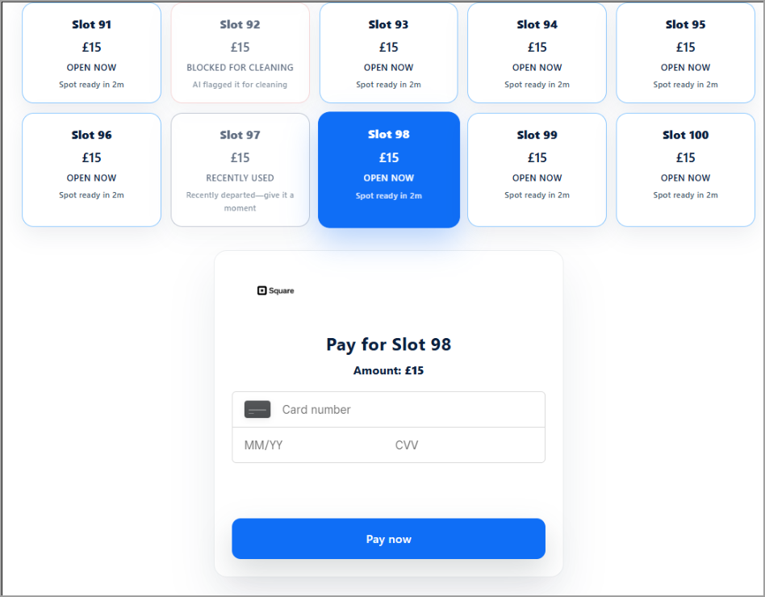


_Figure 11. Real-time parking slot grid driven by SSE updates from GET /spots/stream, showing slot 98 selected with payment form below._ 


### **3.3 Payment Processing with Square SDK** 

PaymentController at /payments handles three things: returning the Square location ID the frontend needs to initialise the SDK, processing a charge, and triggering a refund on a completed payment. 

On the backend, payments are handled in pence rather than pounds to avoid floating point arithmetic errors in financial calculations, so £15.00 is passed as 1500. Each payment request is built with a randomly generated idempotency key, which is important because it means if the request is retried due to a network interruption, Square recognises it as a duplicate and returns the original response rather than processing a second charge. I injected the Square credentials through application properties rather than hardcoded, so switching from sandbox to production is just a configuration change with no code changes needed, and there is no risk of credentials ending up in the repository. 

```
// PaymentService.java — createPayment with UUID idempotency key
public CreatePaymentResponse createPayment(int amountCents, String
sourceId)
        throws ApiException, IOException {
    Money money = new Money.Builder()
        .amount((long) amountCents) // pence, not pounds
        .currency("GBP")
        .build();
    CreatePaymentRequest request = new CreatePaymentRequest.Builder(
        sourceId, UUID.randomUUID().toString()) // sourceId + idempotency
key
        .amountMoney(money)
        .build();
    return squareClient.getPaymentsApi().createPayment(request);
}
```

_Code Snippet 6. PaymentService.java — Square SDK payment creation with UUID idempotency key preventing duplicate charges on network retries._ 

On the frontend, the Square Web Payments SDK is loaded dynamically when the checkout component mounts. Once ready, it injects a sandboxed iframe into the page for card capture. When the user clicks pay, the SDK tokenises the card details by communicating directly with Square's servers and returns a single use token. Raw card data never touches the React application at all. That token is then sent to the backend along with the amount, and the backend handles the actual charge. Also, keeping card data off the server, this approach means the application never needs to worry about PCI compliance at the data storage level since nothing sensitive is ever stored. 

```
// api.js — pay() posting {amountCents, sourceId} to /payments
export async function pay(amountCents, sourceId) {
    const res = await fetch(buildUrl(`/payments`), {
        method: "POST",
        headers: { "Content-Type": "application/json",
...getAuthHeaders() },
        body: JSON.stringify({ amountCents, sourceId }),
    });
    if (!res.ok) throw new Error("Payment failed");
    return res.json();
}
```

_Code Snippet 7. api.js — pay() function posting amountCents (pence integer) and sourceId nonce to POST /payments with JWT Bearer header._ 


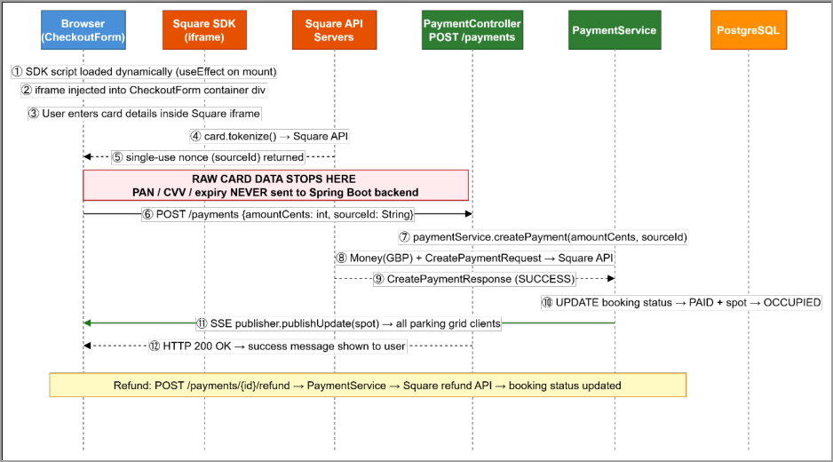


_Figure 12. Payment sequence showing PCI-DSS tokenisation — raw card data never reaches the Spring Boot application server._ 

### **3.4 Dijkstra Route Planning** 

RouteService implements Dijkstra's algorithm over a weighted graph where nodes represent transport interchanges relevant to the stadium journey, tube stations and road junctions, with edge weights representing travel time in minutes. The algorithm runs in **O((V + E) log V) time** , which produces results in under 100 milliseconds on the current topology and scales well if a fuller London transport graph is brought in later through OpenRouteService. 

```
// RouteService.java — Dijkstra implementation
private RouteResult dijkstra(Graph g, String start, String goal) {
    Map<String, Double> dist = new HashMap<>();
    Map<String, String> prev = new HashMap<>();
    for (String id : g.nodes) { dist.put(id, Double.POSITIVE_INFINITY); }
    dist.put(start, 0.0);
    PriorityQueue<String> pq = new PriorityQueue<>(
        Comparator.comparingDouble(dist::get)); // O((V+E)logV)
    pq.add(start);
    while (!pq.isEmpty()) {
        String cur = pq.poll();
        if (cur.equals(goal)) return reconstruct(prev, cur,
dist.get(cur));
        for (Edge e : g.edges(cur)) {
            double alt = dist.get(cur) + e.cost;
            if (alt < dist.getOrDefault(e.to, Double.POSITIVE_INFINITY))
{
                dist.put(e.to, alt); prev.put(e.to, cur); pq.add(e.to);
            }
        }
    }
    return new RouteResult(List.of(), Double.POSITIVE_INFINITY,
ALGORITHM);
}
```


_Code Snippet 8. RouteService.java — Dijkstra priority-queue relaxation loop with predecessor map reconstruction. Complexity O((V+E)logV)._ 

The implementation keeps three data structures running in parallel. A distance map starts every node at infinity except the source which starts at zero. A predecessor map tracks how each node was reached so the path can be reconstructed at the end. A priority queue always processes the lowest cost node next. When the goal node is dequeued, the predecessor map is walked backwards to produce the ordered path and total cost. If a shorter route to a neighbouring node is found during processing, the distance and predecessor maps are updated and that neighbour is requeued. Following extensive testing, the system returns route results from GET /api/travel/route as an ordered list of nodes with associated cost metrics. 


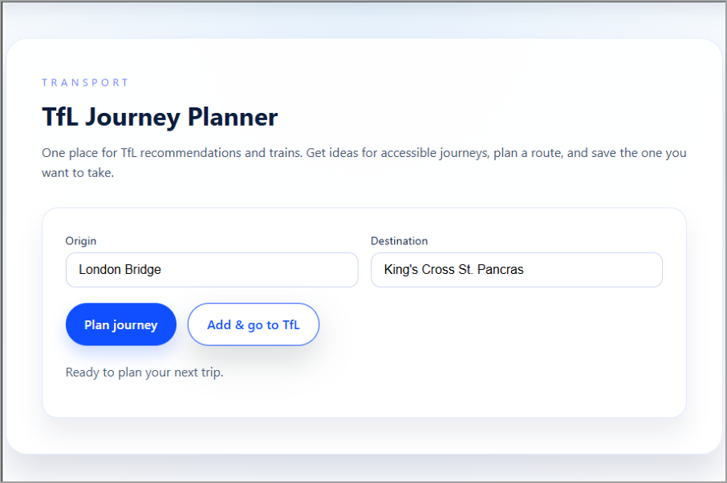


_Figure 13. TfL Journey Planner showing origin/destination inputs backed by Dijkstra route computation via GET /api/travel/route._ 

### **3.5 A* Parking Pathfinding** 

ParkingPathController at GET /api/parking/path runs A* search on a 3x3 grid representing a car park navigation section. Nodes are labelled S00 through S22 with x and y coordinates, and edges connect adjacent nodes horizontally and vertically with a uniform cost of one step. This means that there are no diagonal moves. 

The Manhattan distance heuristic — calculated as the sum of absolute differences in x and y coordinates between a node and the goal — is the provably correct choice for this grid topology because it satisfies the admissibility condition defined by Russell and Norvig (2020): it never overestimates the true cost to reach the goal, since diagonal moves are disallowed and every step costs exactly one unit, meaning the heuristic estimate is always a lower bound on actual path cost, which guarantees A* returns an optimal solution. 


Admissibility is what guarantees A* finds the optimal path. The algorithm scores each node using the actual cost from the start plus the heuristic estimate to the goal, always processing the lowest scoring node next. The key advantage over Dijkstra’s algorithm is that the heuristic directs the search toward the goal, reducing unnecessary node exploration rather than expanding outward in all directions, so fewer nodes get explored on the way to the answer. 

```
// ParkingPathController.java — A* with Manhattan heuristic
static ToDoubleBiFunction<Node,Node> manhattan =
    (n,g) -> Math.abs(n.x-g.x) + Math.abs(n.y-g.y); // admissible
heuristic
@GetMapping("/path")
public ResponseEntity<?> path(@RequestParam String start, @RequestParam
String goal) {
    Graph g = new Graph();
    for (int i=0; i<3; i++) for (int j=0; j<3; j++)
        g.addNode(new Node("S"+i+j, i, j));
    for (int i=0; i<3; i++) for (int j=0; j<3; j++) {
        String id = "S"+i+j;
        if (i<2) g.addEdge(new Edge(id, "S"+(i+1)+j, 1));
        if (j<2) g.addEdge(new Edge(id, "S"+i+(j+1), 1));
    }
    Route r = aStar(g, start, goal, manhattan);
    return ResponseEntity.ok(Map.of(
        "nodes", r.path, "steps", r.cost, "algorithm", "A_STAR"));
}
```

_Code Snippet 9. ParkingPathController.java — A* with admissible Manhattan heuristic on a 3×3 parking grid. Admissibility guarantees optimal path._ 


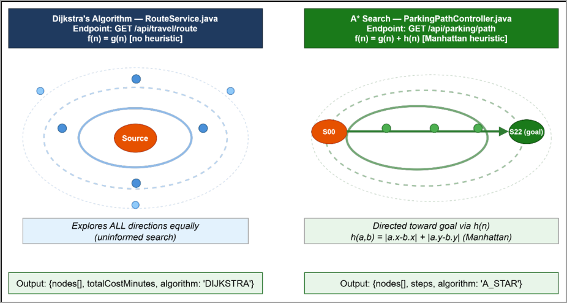


_Figure 14. Dijkstra uninformed radial expansion versus A* heuristic-directed search — the Manhattan admissible heuristic ensures optimality while exploring fewer nodes._ 


### **3.6 Live Transport Status and TfL Integration** 

TfLService and TrainService feed transport data into TravelController and JourneyController. The GET /api/travel/plan endpoint combines Dijkstra route output, live train service data, and TfL journey plan results into a single response that the frontend renders as a unified journey summary covering route nodes, train availability, and estimated journey time. 

Live TfL line status is fetched directly from the frontend rather than proxied through the backend. This is because the data is publicly accessible, read-only, and does not require authentication or backend processing. Proxying it through the backend would add latency, use up backend thread capacity, and create unnecessary coupling between frontend and backend deployment cycles. 

When TfL returns multiple station matches for an ambiguous input, for example if someone types London, the TravelPlanner component detects the disambiguation response and shows a selectable list of suggestions. The user picks the correct station, and the journey plan request is resubmitted with the precise identifier. Disambiguation was built in from the start because silently picking the wrong station and returning a nonsensical route would be a reliability failure, and that kind of mistake under matchday time pressure is exactly the sort of thing that makes users lose trust in an application. 


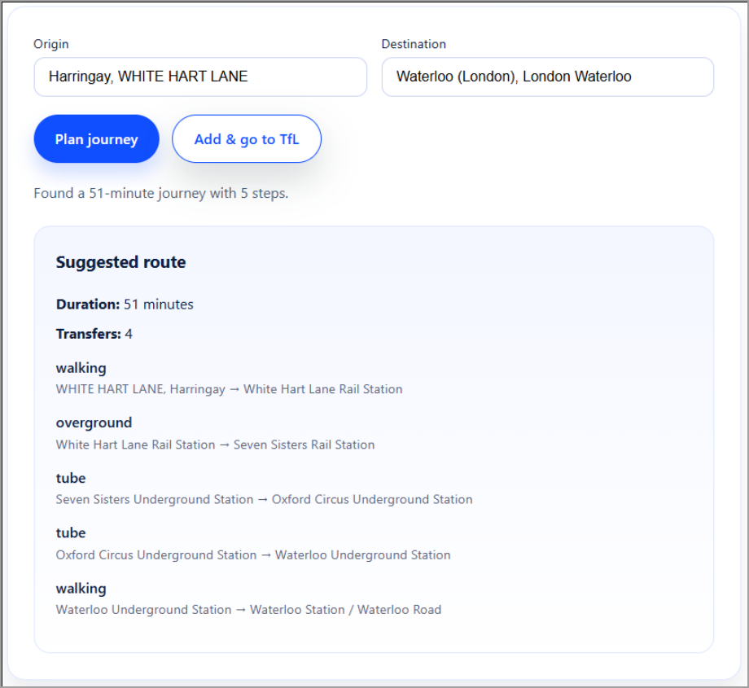


_Figure 15. TfL Status Dashboard with conditional Leaflet map showing the London Overground route and White Hart Lane stadium marker._ 


### **3.7 Data Model and Persistence** 

The schema defines five tables, all in Third Normal Form meaning no attribute depends on anything other than the primary key. 

- **Users** :user_id (BIGSERIAL PK), email (UNIQUE NOT NULL), password (BCrypt hash, never plaintext), first_name, last_name, last_login (TIMESTAMP for audit) 

- **parking_spots** :spot_id (PK), spot_number, status (AVAILABLE / OCCUPIED / RESERVED), is_accessible (BOOLEAN for Blue Badge spaces), version (INT DEFAULT 0 for JPA optimistic locking) 

- **bookings** :booking_id (PK), user_id (FK → users ON DELETE CASCADE, supporting GDPR right-to-erasure), spot_id (FK → parking_spots), start_time, end_time, status (PENDING → PAID → CANCELLED), version (INT DEFAULT 0 for optimistic locking) 

- **payments** :payment_id (PK), booking_id (FK → bookings ON DELETE CASCADE), amount (INT in pence, consistent with Square's minor-unit API), source_id (Square nonce for audit trail without storing raw card data), payment_status, created_at 

- **accessibility_preferences** : pref_id (PK), user_id (FK → users ON DELETE CASCADE), font_size (INT DEFAULT 16), high_contrast, screen_reader, reduce_motion, step_free (all BOOLEAN DEFAULT FALSE) 

I chose Third Normal Form because it eliminates redundant data and keeps the schema clean as the application grows. The ON DELETE CASCADE constraints were a deliberate decision to support GDPR right-to-erasure, so deleting an account automatically removes all associated records without needing a separate cleanup process. 


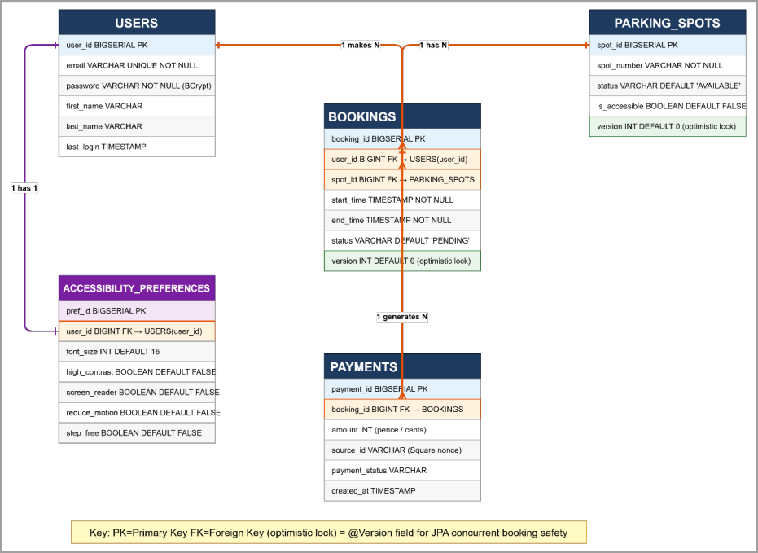


_Figure 16. Entity Relationship Diagram — five tables in 3NF with cascade delete supporting rightto-erasure and @Version columns for optimistic locking concurrency control._ 


### **3.8 Term 2 Roadmap Delivery: Admin Dashboard and Containerised Deployment** 

Both planned roadmap items from the interim submission were completed in Term 2. 

The admin dashboard sits under /api/admin with AdminService handling business logic and AdminAuthorizationService handling role validation. It covers aggregate metrics including total users, bookings, revenue, and section occupancy, parking section management, and user role promotion. I put role validation in a dedicated AdminAuthorizationService rather than relying solely on Spring Security annotations because it gives a testable, auditable service layer checkpoint. When a caller lacks the ADMIN role, assertAdmin() throws AccessDeniedException which GlobalExceptionHandler maps to HTTP 403. 

The admin role is stored as a string field on the User entity, either USER or ADMIN. A separate roles table was not worth the added complexity given the role set is fixed at two values. To reach the dashboard, a user logs in with the dedicated admin entry code for example pin code 2005. 

`// AdminAuthorizationService.java — role validation public void assertAdmin(String adminEmail) { if (adminEmail == null || adminEmail.isBlank()) { throw new AccessDeniedException("Admin email header is required"); } User user = userRepository.findByEmail(adminEmail.trim()) .orElseThrow(() -> new AccessDeniedException("Admin user not found")); if (!"ADMIN".equalsIgnoreCase(user.getRole())) { throw new AccessDeniedException("Access denied: ADMIN role required"); } } // AdminController.java — dashboard endpoint @GetMapping("/dashboard") public ResponseEntity<Map<String,Object>> dashboard( @RequestHeader("X-Admin-Email") String adminEmail) { adminAuthorizationService.assertAdmin(adminEmail); return ResponseEntity.ok(adminService.getDashboardMetrics()); }` _Code Snippet 10. AdminAuthorizationService.assertAdmin() role check and AdminController dashboard endpoint — role validation occurs in the service layer before any data_ 

_is returned._ 


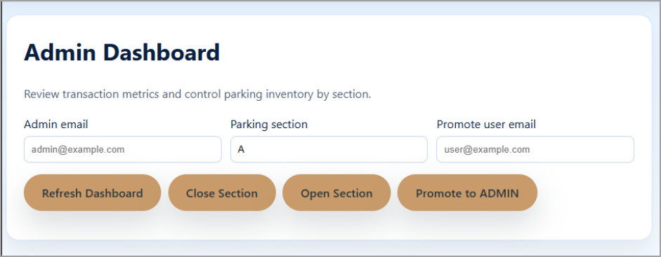


_Figure 17. dashboard showing aggregate metrics, recent booking transactions, and parking section open/close controls._ 

Docker containerisation was the second roadmap item. The backend uses a multi-stage Dockerfile that compiles the Spring Boot application with Maven then copies only the JAR into a slim JRE-17 runtime image, keeping the final image small and free of build tooling. The frontend builds with Node.js and serves static output through Nginx. Docker Compose orchestrates all three services, PostgreSQL, backend, and frontend, with healthcheck-gated startup ordering so nothing starts before its dependency is ready. I have chosen to do this objective as all credentials are injected as environment variables, meaning the same image runs in sandbox or production just by changing the environment configuration with no code changes or rebuilds needed. The full stack starts with a single command: docker compose up --build. 


## Chapter 4: **Software Engineering Process and Quality Strategy** 

This chapter pulls together the software engineering side of the project — requirements, architecture, methodology, version control, testing, and deployment — into one dedicated chapter rather than leaving these topics scattered across the report as they were in the interim submission. 

### **4.1 Requirements Engineering** 

Requirements came from mapping the full matchday user journey end to end and asking at each step what the system must provide for the user to move forward, rather than brainstorming what the system could do. That distinction matters because it ties every feature to a real user need, which makes scope decisions much easier to justify and keeps the backlog focused. 

Scope decisions used three criteria. User journey impact meant features on the critical path came first — without authentication booking is impossible, and without booking payment has nothing to act on. Implementation dependency ordering meant authentication had to be stable before booking was built, and booking had to be stable before payment made sense to tackle, because testing later features without earlier ones working is unreliable. 

External API risk meant Cabwise was staged after TfL because its response structure turned out to be variable in early experiments, and the fallback mechanism was designed before the live integration was attempted rather than after problems surfaced. 


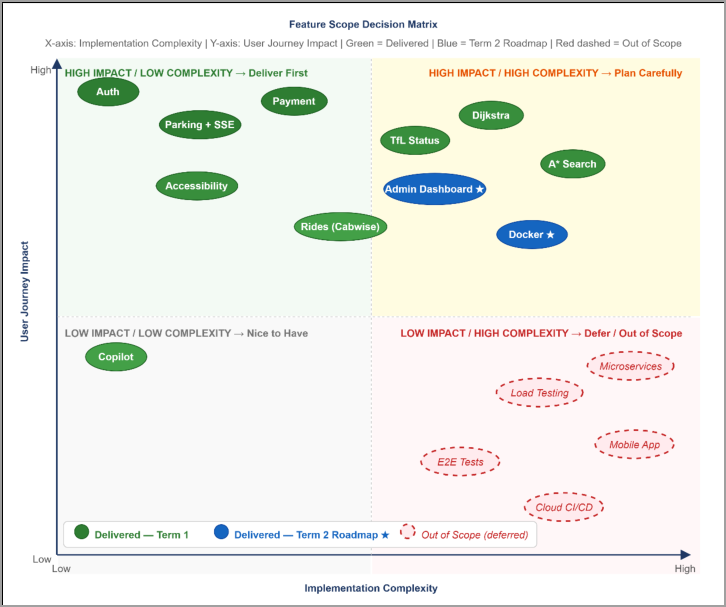


_Figure 18. Scope decision matrix — features prioritised by user journey impact versus implementation complexity, with out-of-scope items clearly marked. Admin Dashboard and Docker are shown as Term 2 delivered items._ 


### **4.2 Architectural Design** 

The layered architecture enforces unidirectional dependencies through Spring's DI container, meaning a controller cannot directly call a repository and bypass the service layer. In practice every time a new feature was added across both terms, the pattern was always the same: new controller, new service, new repository, new test class. Besides, no existing class needed to be modified to accommodate a new feature domain, which is the open-closed principle working as intended rather than just being cited as theory. 

The frontend follows the same logic. Router.jsx defines routes, page components handle their own data fetching through api.js, shared concerns like accessibility state live in their own provider, and reusable UI elements are kept as stateless components. That separation meant changes to one part of the frontend rarely rippled into others. 


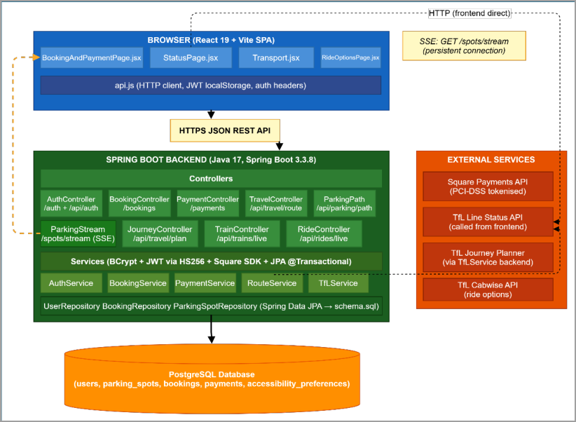


_Figure 19. Complete layered architecture with all named controller, service, and repository classes from the real codebase including Term 2 additions (AdminController, AdminService, AdminAuthorizationService)._ 


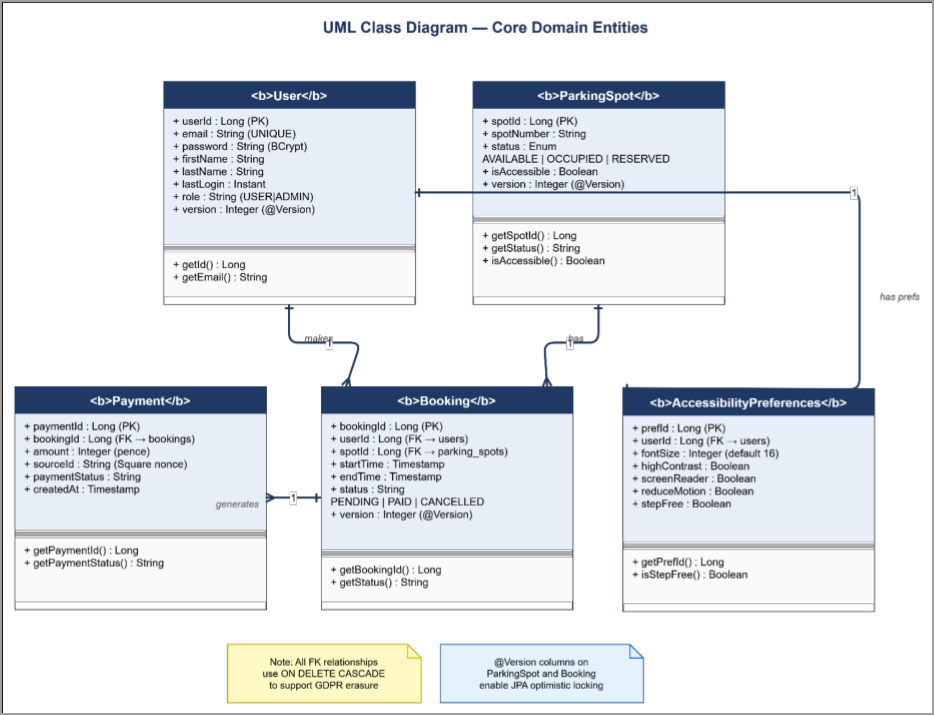


_Figure 20. UML class diagram showing core domain entities and their attributes._ 

### **4.3 Development Methodology and Version Control** 

Waterfall was rejected because it pushes integration to the end, meaning issues like the JWT filter and CORS problem that cost four unplanned development days in Term 1 Week 11 would only surface after everything was built, leaving little room to fix them without significant rework. Likewise, Scrum was ruled out because its ceremony, daily standups, sprint reviews, Product Owner and Scrum Master roles, adds real value when coordinating a team but brings no benefit to a solo developer and would just eat into implementation and testing time. 

An iterative incremental approach was chosen instead. Features are built as complete vertical slices that each validate the full path from frontend through backend to database. The practical benefit is that integration problems show up as early as possible. If the SSE connection could not be established, that would be discovered when the SSE feature was first built rather than at the end of the project when there is no time left to deal with it. 

|**Methodology**|**Integration Risk**|**Single-Dev Fit**|**API-Risk Handling**|**Selected**|
|---|---|---|---|---|
|Waterfall|Late (post-build)|Good for stable<br>reqs|Poor — assumes fixed reqs|No|


|**Methodology**|**Integration Risk**|**Single-Dev Fit**|**API-Risk Handling**|**Selected**|
|---|---|---|---|---|
|Scrum / Agile|Each sprint|Good — short<br>cycles|Moderate<br>—<br>team<br>ceremonies|No|
|Iterative-<br>Incremental|Each feature slice|Excellent<br>—<br>early integration|Excellent — adapts to API<br>changes|**YES**✓|


_Table 3. Development methodology comparison — Iterative-Incremental selected for API risk management and single-developer suitability._ 

Term 1 focused on authentication, parking with SSE, and Square payment, deliberately tackling the three highest risk integrations first to confirm the core architecture was solid before building anything on top of it. Term 2 then delivered TfL and Cabwise integrations, Dijkstra and A* implementations, the accessibility context, chat assistant, admin dashboard, Docker containerisation, and the full testing hardening pass. 

Version control used a Git feature branch workflow on GitHub with branches named by feature domain, for example feature/auth, feature/parking-sse, feature/square-payment, and feature/admindashboard. Branches were merged to main via pull request only after local tests passed. Commit messages were written to describe what changed and why, for example "Add BCrypt password encoding to AuthService.register()" rather than something vague like "Update service", which makes the history a useful record of decisions rather than just a changelog. The commit history runs from initial project setup in October 2025 through to the final regression checks in April 2026, giving an auditable timeline that backs up both the diary entries and this report. 


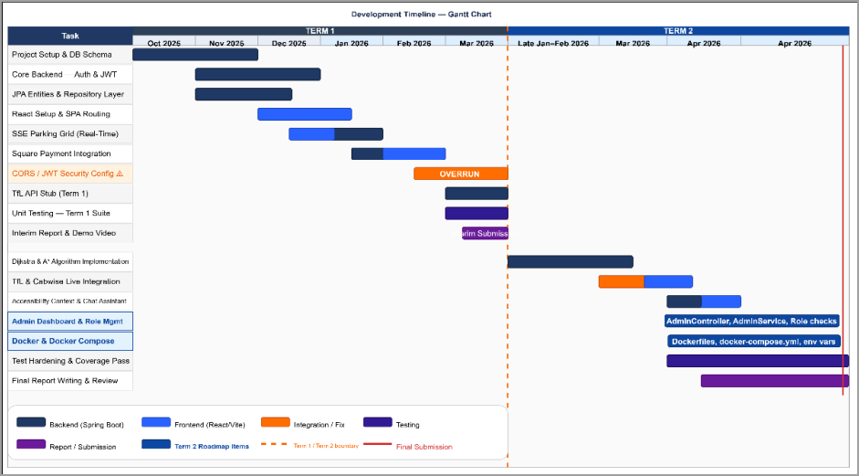


_Figure 21. Development timeline Gantt chart derived from diary.md, showing iterative delivery across both terms. Admin Dashboard and Docker Compose are shown as completed Term 2 deliverables (dark green)._ 


I made sure each vertical slice followed the same interna pattern: backend endpoint and service implementation, then repository and integration tests, then frontend page development, then frontend component tests. Doing it this way meant completed features were always tested and working rather than partially built and left to be validated later. 

### **4.4 Testing Strategy** 

#### **4.4.1 Backend Testing** 

The backend test suite uses JUnit 5 and Mockito with H2 in-memory database for repository tests and JaCoCo for coverage reporting. The core principle is dependency isolation, no test depends on real external systems. Service tests use Mockito.mock() for repository and SDK dependencies so failures point to logic errors rather than infrastructure problems. Also, controller tests use MockMvc with @WebMvcTest which starts only the web layer, keeping them fast. 

|**Category**|**Example Classes**|**What Is Validated**|
|---|---|---|
|Controller|AuthControllerTest,<br>BookingControllerTest,<br>PaymentControllerTest|HTTP status codes, response body,<br>JWT filter behaviour|
|Service|AuthServiceTest,<br>BookingServiceTest,<br>RouteServiceTest|Business logic, state transitions,<br>exception throwing|
|Repository|UserRepositoryContractTest,<br>BookingRepositoryContractTest|Custom queries, JPA constraints,<br>cascade delete|
|Model/DTO|UserTest,BookingTest,<br>PaymentRequestTest|Constructors, getters, null handling|
|Security|JwtUtilTest,SecurityConfigTest,<br>CorsConfigTest|Token<br>generation,<br>filter<br>chain,<br>CORS enforcement|
|SSE|ParkingAvailabilityPublisherTest|Emitter lifecycle, update delivery,<br>disconnected client removal|


_Table 4. Backend and frontend test categories with example classes and validation scope._ 


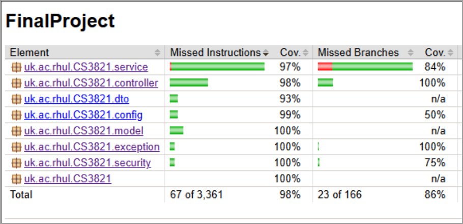


_Figure 22._ Backend test run showing 116 tests passing with BUILD SUCCESS and JaCoCo coverage report showing 98% instruction coverage across service and controller layers. 

As shown in Figure 4.6, the backend test run achieved 116 tests passing with BUILD SUCCESS. The JaCoCo report shows 98% instruction coverage overall, with the service layer at 97% and controller layer at 98%. 

#### **4.4.2 Frontend Testing** 

Frontend testing uses Vitest, React Testing Library, and jsdom. API calls are mocked via vi.mock('./api') so no real HTTP requests are made during tests. Page tests render components, interact via userEvent, and assert on DOM state and api.js call behaviour. V8 coverage is configured in vite.config.js and generates a report at frontend/coverage/index.html. 


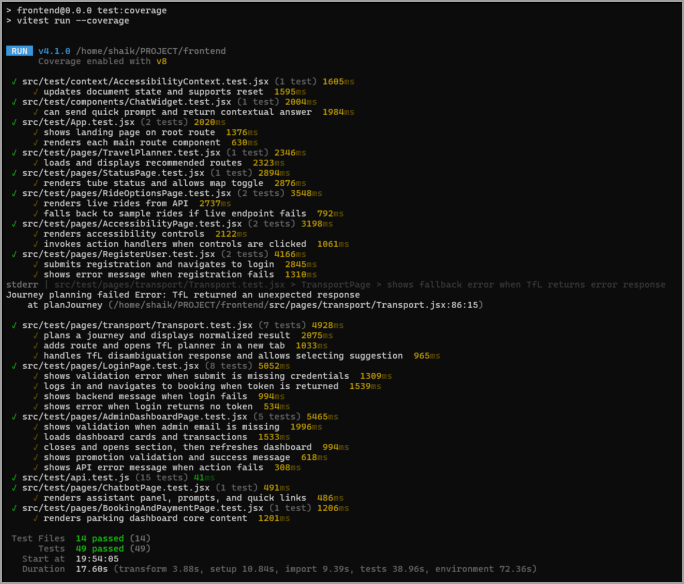


_Figure 23. Frontend test run output with Vitest and V8 coverage across page, component, and context test files including admin page tests._ 


#### **4.4.3 Integration Testing** 

Square Sandbox validated the full payment success path using cnon:card-nonce-ok and the failure path using cnon:card-nonce-declined, confirming no booking record is created and no spot status changes on a declined payment. JWT security confirmed protected endpoints return HTTP 401 without a token and HTTP 200 with a valid one, while public travel endpoints return HTTP 200 without authentication as intended by the SecurityConfig permit rules. 

Concurrency testing with two simultaneous browser sessions confirmed slot updates propagate via SSE within around 500ms, and optimistic locking was verified through competing mock transactions in BookingService. Admin integration confirmed HTTP 403 without an ADMIN role header and correct metrics with a promoted account, with section close and open changes broadcasting correctly via SSE. 

#### **4.4.4 Accessibility Audit** 

The application was audited using Google Chrome Lighthouse against WCAG 2.1 standards. The initial neon colour theme produced low contrast scores on elements like the login button, which was fixed by darkening CSS variables on interactive elements. The final audit shown in Figure 4.7 achieved 98/100 for accessibility and 100/100 for best practices, validating that the WCAG 2.1 implementation through AccessibilityContext is effective beyond just having the controls in place. 


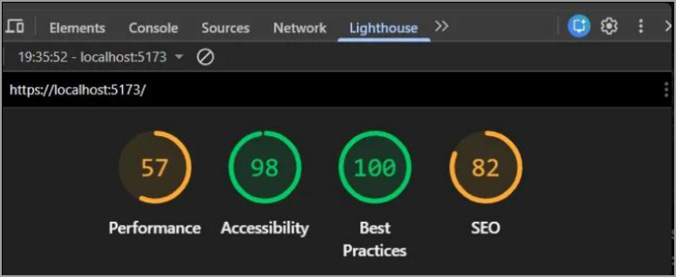


_Figure 24. Google Lighthouse audit showing Accessibility 98, Best Practices 100, Performance 57, SEO 82._ 

### **4.5 Scaling and Deployment Considerations** 

The JWT authentication model is horizontally scalable by design since authentication state is carried in the token rather than server-side sessions. Any backend instance can process requests without shared infrastructure, so a second Spring Boot instance can be added behind a load balancer with no code changes. HikariCP manages the PostgreSQL connection pool, which should be tuned to match database capacity as booking load grows. 

The main scaling limitation is the SSE architecture. Parking updates published on one backend instance only reach clients connected to that instance. In a multi-instance deployment, a user on Instance 1 would not receive updates from a booking made on Instance 2. The solution is a shared message broker such as Redis Pub/Sub, where each instance publishes to a common topic and forwards updates to its local SSE clients. This is identified as a medium-term improvement in Section 1.7.3. 

The Docker Compose setup from Term 2 is an initial step toward production deployment. Environment-variable-based configuration allows the same image to run in sandbox or production with only configuration changes. Next steps include a GitHub Actions CI/CD pipeline to automate testing and image builds, Spring Boot Actuator exposing a /health endpoint for load balancer checks, and Grafana dashboards for observability. 


## Chapter 5: **Critical Analysis, Reflection, and Future Improvements** 

### **5.1 Achievements and Successes** 

The main achievement is the integration breadth delivered at genuine engineering quality. The application covers eight functional domains in one coherent matchday workflow, which directly solves the fragmentation problem I set out to address. Every component I built, from SSE parking updates and Square tokenisation to Dijkstra routing, TfL disambiguation, Cabwise fallback, and AccessibilityContext persistence, was designed to serve the reliability of the overall user journey rather than just demonstrating a technical capability in isolation. 

One decision I am particularly satisfied with is choosing SSE over polling for the parking grid. Polling introduces a window between requests where two users can simultaneously see the same slot as available and both attempt to book it. I chose SSE because it closes that window by pushing state changes to all connected clients within around 500ms of a booking being confirmed, which is the only approach that meaningfully prevents double-booking under real concurrent matchday load. 

The layered architecture proved its value across both terms. I added nine feature verticals without any structural refactoring of existing code. In Term 2 I introduced the admin dashboard as a completely new domain, AdminController, AdminService, and AdminAuthorizationService, without touching any existing controller or service class. That is the open-closed principle working in practice rather than just being cited in theory. I added Docker containerisation the same way, only Dockerfiles, docker-compose.yml, and environment variable configuration were new, which confirmed the architecture was environment portable from the start. 

The test suite I built covers controllers, services, models, repositories, DTOs, security utilities, pages, components, and context state, giving credible quality evidence at every layer. AccessibilityContext in particular shows that I treated accessibility as an engineering concern from day one, building it as a cross-cutting provider at the application root rather than a toggle bolted onto a single page. 

### **5.2 Difficulties and Failures** 

The most significant difficulty I faced was the JWT filter chain and CORS configuration problem in Term 1 Week 11. Getting Spring Security filter ordering, CORS preflight handling for OPTIONS requests, and the dual-prefix AuthController mapping all working together correctly took four unplanned development days, a 33% overrun on the planned integration budget for that phase. The root cause was that I underestimated how tightly those concerns interact with each other. That time loss compressed the final weeks of Term 1 and meant I had to deprioritise load testing, the user profile history UI, and email booking confirmation to protect the core deliverables. 

The route graph is also a limitation I need to be transparent about. The Dijkstra graph runs on a predefined demonstration topology and the A* grid is a 3x3 demo geometry rather than a real car park layout. I judged that delivering correct algorithms with demonstration data was preferable to attempting OpenRouteService integration under time pressure, but the gap between algorithmic correctness and practical usefulness is real and needs to be stated clearly rather than glossed over. 

The SecurityConfig CSRF configuration uses ignoringRequestMatchers on /api/** which is broader than it needs to be, and the dual-prefix AuthController mapping adds unnecessary surface area. Both are near-term improvement actions I have identified in the roadmap. The absence of a 


refresh token is the most user-facing limitation. When the JWT expires the user has to reauthenticate, which in a matchday scenario where a fan spends several hours at the stadium could mean an inconvenient mid-session re-login. That is the highest priority near-term fix. 

### **5.3 Project Management Reflection** 

Term 1 planning scheduled nine weeks for project setup, core backend, and frontend integration, with two weeks for external API integration and hardening. The first three phases were delivered broadly on schedule. The integration phase overran by four days due to the security configuration issues covered above. Deprioritising supplementary features to protect the core deliverables was the right call in hindsight, but it confirmed that security infrastructure configuration needs dedicated buffer time in any future plan because its debugging cost is non-linear and genuinely hard to estimate before the specific conflict is encountered. If I were to redo my Gantt chart I would add a review phase in the middle to allow me to decide whether certain features should be cut before they impact the critical path. 

Term 2 followed the planned sequence, Dijkstra and A* first given the highest algorithm complexity risk, then TfL and Cabwise, then accessibility, assistant, admin dashboard, Docker containerisation, testing hardening, and report writing. Both the admin dashboard and Docker Compose were completed within the Term 2 timeline, which confirmed the Term 1 roadmap planning was realistic. 

The biggest process lesson I took from both terms is that report architecture should be planned alongside code architecture from week one. The structural work required between interim and final submissions, creating a dedicated software engineering chapter, expanding background theory into three-option comparisons, growing user stories from four to twenty-two, and reformatting the bibliography, consumed significant time in the final weeks that could have been distributed more evenly if I had kept a living report outline from the start. If I were starting again I would define the report chapter structure and code architecture on the same day. I would allocate diary entries to report sections during Term 1 rather than writing the report entirely in Term 2. I would also budget four extra days for any security related integration task, and I would implement the refresh token mechanism in Term 1 alongside the initial JWT work, because adding it later meant revisiting the auth flow, frontend token storage, and security configuration all at once. 

### **5.4 Future Improvements** 

The most impactful near-term change would be replacing the demonstration route graph with real geospatial data from OpenRouteService, using actual North London transport interchange coordinates and real travel time estimates. That would make GET /api/travel/route produce practically useful recommendations rather than just demonstrating the algorithm. In addition, I would add a refresh token rotation endpoint at POST /api/auth/refresh with explicit revocation via DELETE /api/auth/logout, and a password reset flow covering POST /api/auth/forgot-password and POST /api/auth/reset-password. The CSRF configuration needs tightening from the broad /api/** ignore to specific endpoint patterns, and I would add Playwright or Cypress end-to-end browser tests to validate complete user journeys on a deployed instance. 

Cloud deployment on AWS or Render would be the natural next step, building directly on the Docker containerisation already in place. JMeter load testing would follow to empirically measure how the system behaves under simulated stadium-scale booking surges, since the optimistic locking and SSE architecture provide correctness guarantees in theory but the actual performance bounds under hundreds of simultaneous attempts have not been measured. I would also strengthen admin role enforcement by embedding the role claim directly in the JWT payload and validating it 


through Spring Security @PreAuthorize, replacing the current X-Admin-Email header approach which works for demonstration but is less robust. 

#### **5.4.1 Out-of-Scope Long-Term** 

Extracting the payment domain into an independently deployable microservice would make sense once fault isolation requirements emerge at production scale, but I would not add that complexity before those requirements actually arise. A native iOS and Android application using React Native would enable proper push notifications for departure reminders and booking confirmations, which web push cannot reliably deliver across all browser environments. I would also want to extend the accessibility work further with a simplified language mode and dyslexia-friendly font options, since the current implementation covers visual and motion preferences well but cognitive accessibility deserves more attention. Overlaying real-time vehicle position data on the transport map would show live bus and train positions approaching the stadium rather than just static line status. 

Finally, full GDPR compliance infrastructure covering lawful basis documentation, data subject access request workflows, and a data protection impact assessment would be required before any public-facing deployment under UK GDPR. The technical decisions I made around data minimisation and cascade deletion point in the right direction, but the governance layer still needs to be built out properly. 

### **5.5 Assessment Against Aims** 

Looking back at the four aims set out in Section 1.1.2, I can say with confidence that the first aim was fully achieved. The application is stable, demonstrable, and executable. A matchday visitor can register an account, check live transport status, plan a route, browse the real-time parking grid, complete a tokenised card payment, and access ride alternatives all within one continuous session. The submitted codebase runs locally via mvn spring-boot:run and npm run dev, and the Docker Compose setup brings up the full stack with a single command. Every core feature is present, tested, and working. 

The second aim, demonstrating software engineering maturity, was also achieved. The layered architecture enforces clean separation between controllers, services, and repositories. All main feature verticals were delivered across two terms without any structural refactoring. The test suite achieves 98% instruction coverage across 116 backend tests and covers all frontend pages and components. Version control shows a consistent feature branch workflow from October 2025 through to April 2026 with descriptive commit messages at every stage. 

The third aim of integrating external services responsibly was partially achieved. TfL journey planning with station disambiguation, the Cabwise API with explicit fallback, and Square tokenisation with idempotency key protection all demonstrate responsible integration design. The limitation is that the Dijkstra route graph and A* grid use demonstration topologies rather than real geospatial data, which means the practical value of those integrations is constrained even though the algorithmic and API layers are correctly implemented. 

The fourth aim of treating accessibility as a first-class engineering obligation was fully achieved. AccessibilityContext delivers five persistent preferences across every page in the application without resetting on navigation. The Lighthouse audit returned 98/100 for accessibility and 100/100 for best practices. The step-free preference has real functional consequences on TfL route recommendations rather than being a cosmetic toggle, which demonstrates that accessibility was built into the system architecture rather than added as an afterthought. 


## Chapter 6: **Conclusion** 

This project delivered a full-stack matchday travel and parking assistant for Tottenham Hotspur Stadium visitors, integrating eight functional domains into one coherent application addressing the fragmentation problem motivating the work. The technical contribution spans N-tier layered architecture with testable service boundaries and stable API contracts, real-time SSE parking updates with JPA optimistic locking for concurrency safety, tokenised payment via Square Web SDK, Dijkstra shortest-path and A* heuristic pathfinding with labelled API outputs, TfL journey planning with disambiguation handling, Cabwise ride integration with graceful fallback, a persistent global AccessibilityContext propagating five user preferences in compliance with WCAG 2.1, a role-based admin dashboard for transaction monitoring and parking section management, and Docker Compose containerisation for reproducible deployment. 

The process contribution demonstrates iterative delivery across two terms. The three highest-risk integrations—authentication, SSE parking, and Square payment—were delivered first to validate the core architecture. Features were implemented as complete vertical slices with test coverage at each stage, both Term 2 roadmap items were completed, and interim feedback was systematically incorporated: expanding background theory into comparative analyses, adding a dedicated software engineering chapter, increasing user stories from four to twenty-two, and extending the bibliography with academic sources. All implementation claims are grounded in verified code, ensuring class names, method signatures, endpoints, and data models accurately reflect the submitted system. 

The project demonstrates that practical value and academic rigour are not mutually exclusive. A system solving a real urban mobility problem can be built to engineering standards supporting reproducibility, structured evaluation, and a transparent path from academic prototype to production system. 

In conclusion, the skills developed across this project—backend architecture, React SPA development, JWT security, real-time event streaming, payment SDK integration, graph algorithm implementation, relational database design, role-based access control, and containerised deployment—are directly applicable to full-stack and platform engineering roles. Remaining gaps—demonstration route graphs, absent refresh tokens, permissive CSRF configuration, and lack of cloud deployment—are acknowledged with a concrete improvement roadmap rather than obscured, reflecting the BCS Code of Conduct principle that professional engineers represent system capabilities and limitations accurately to stakeholders. 


## **Bibliography** 

[1] Cormen, T.H., Leiserson, C.E., Rivest, R.L. and Stein, C. (2022) _Introduction to Algorithms_ . 4th edn. Cambridge, MA: MIT Press. 

[2] Walls, C. (2022) _Spring Boot in Action_ . 2nd edn. Shelter Island, NY: Manning Publications. 

[3] Freeman, A. (2022) _Pro React 18_ . Berkeley, CA: Apress. 

[4] Fowler, M. (2002) _Patterns of Enterprise Application Architecture_ . Boston, MA: AddisonWesley. 

[5] Banks, A. and Porcello, E. (2020) _Learning React: Modern Patterns for Developing React Apps_ . 2nd edn. Sebastopol, CA: O'Reilly Media. 

[6] Russell, S. and Norvig, P. (2020) _Artificial Intelligence: A Modern Approach_ . 4th edn. Hoboken, NJ: Pearson. 

[7] Newman, S. (2021) _Building Microservices_ . 2nd edn. Sebastopol, CA: O'Reilly Media. 

[8] Humble, J. and Farley, D. (2010) _Continuous Delivery_ . Boston, MA: Addison-Wesley. 

[9] Gamma, E., Helm, R., Johnson, R. and Vlissides, J. (1994) _Design Patterns: Elements of Reusable Object-Oriented Software_ . Boston, MA: Addison-Wesley. 

[10] Kleppmann, M. (2017) _Designing Data-Intensive Applications_ . Sebastopol, CA: O'Reilly Media. 

[11] Shore, J. and Warden, S. (2021) _The Art of Agile Development_ . 2nd edn. Sebastopol, CA: O'Reilly Media. 

[12] Nygard, M.T. (2018) _Release It!: Design and Deploy Production-Ready Software_ . 2nd edn. Raleigh, NC: Pragmatic Bookshelf. 

[13] Wohlin, C., Runeson, P., Höst, M., Ohlsson, M.C., Regnell, B. and Wesslén, A. (2012) _Experimentation in Software Engineering_ . Berlin: Springer. 

[14] Lauret, A. (2019) _The Design of Web APIs_ . Shelter Island, NY: Manning Publications. 

[15] Syer, D. (2023) _Spring Security in Action_ . 2nd edn. Shelter Island, NY: Manning Publications. 

[16] Fielding, R.T. (2000) _Architectural Styles and the Design of Network-based Software Architectures_ . PhD thesis, University of California, Irvine. 

[17] Bast, H., Delling, D., Goldberg, A., Müller-Hannemann, M., Pajor, T., Sanders, P., Wagner, D. and Werneck, R. (2016) ‘Route Planning in Transportation Networks’, in Kliemann, L. and Sanders, P. (eds.) _Algorithm Engineering_ . Springer, pp. 19–80. 

[18] Spring Framework (2025) _Spring Boot Reference Documentation_ . Available at: https://docs.spring.io/spring-boot/docs/current/reference/html/ 

- [19] Spring Security (2025) _Spring Security Reference Documentation_ . Available at: https://docs.spring.io/spring-security/reference/ 


[20] Square Developer (2025) _Square Payments API and Web SDK Documentation_ . Available at: https://developer.squareup.com/docs 

[21] Transport for London (2025) _TfL Unified API Documentation and Cabwise API Reference_ . Available at: https://api.tfl.gov.uk/ 

[22] W3C (2018) _Web Content Accessibility Guidelines (WCAG) 2.1_ . Available at: https://www.w3.org/TR/WCAG21/ 

[23] React (2025) _React Documentation_ . Available at: https://react.dev/ 

[24] Vite (2025) _Vite Next Generation Frontend Tooling_ . Available at: https://vitejs.dev/ 

[25] PostgreSQL Global Development Group (2025) _PostgreSQL 16 Documentation_ . Available at: https://www.postgresql.org/docs/ 

[26] Mozilla Developer Network (2025) _Using Server-Sent Events_ . Available at: https://developer.mozilla.org/en-US/docs/Web/API/Server-sent_events 

[27] OWASP Foundation (2021) _OWASP Top Ten 2021_ . Available at: https://owasp.org/wwwproject-top-ten/ 

[28] IETF (2015) _RFC 7519: JSON Web Token (JWT)_ . Available at: https://datatracker.ietf.org/doc/html/rfc7519 

[29] British Computer Society (2022) _BCS Code of Conduct_ . Available at: https://www.bcs.org/membership-and-registrations/become-a-member/bcs-code-of-conduct/ 


## **Appendix A: User Manual** 

This manual covers every feature of the Tottenham Hotspur Stadium Travel and Parking Assistant. The application is designed to take matchday visitors through the full journey planning process — from creating an account to having confirmed parking and travel arrangements — without needing to switch between separate apps at any point. 

### **SECTION 1  —  Getting Started** 

#### **1.1  Registering a New Account** 

Go to /register from the home screen. Fill in your full name, email address, and a password, then click Register. If everything goes through correctly you will be logged in automatically and taken to the home page. Passwords are stored using BCrypt hashing so they are never held or sent in plaintext at any point. 


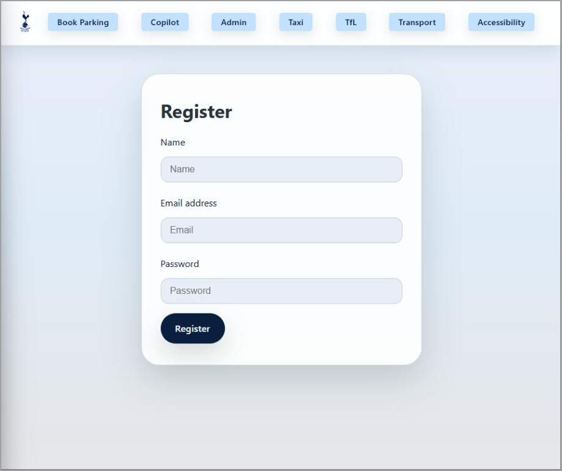


Figure 25. Registration page showing the name, email, and password fields 


#### **1.2  Logging In** 

Go to /login and enter your email and password. If the credentials are wrong, a specific error message appears below the form rather than a generic failure message. On a successful login you are taken to the home page and your session carries across all pages automatically. The session is kept alive through a JWT stored in your browser's localStorage and stays active until the token expires or you clear your browser data. 


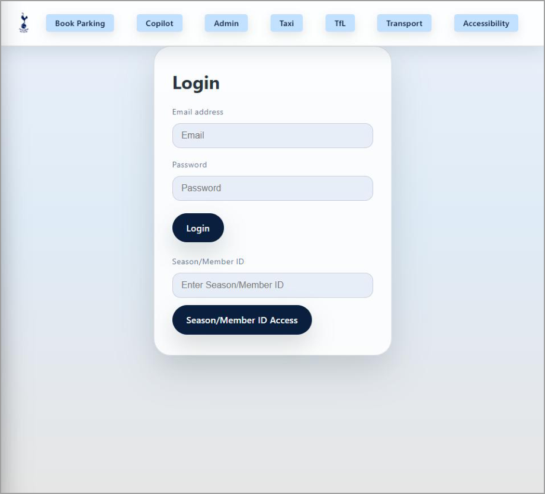


_Figure 26. Login page showing the email and password fields_ 

#### **1.3  Season/Member ID Access** 

If you have been given a Season or Member ID, enter it in the Season/Member ID field on the login page and click the access button. Codes 2005 or 2025 will take you directly to the Admin Dashboard. 


### **SECTION 2  —  Booking Parking** 

#### **2.1  Browsing the Parking Grid** 

Go to /booking to see the live parking grid. Slot statuses update automatically as other users book or cancel — you do not need to refresh the page. Green means available, red means occupied, and grey means reserved. 


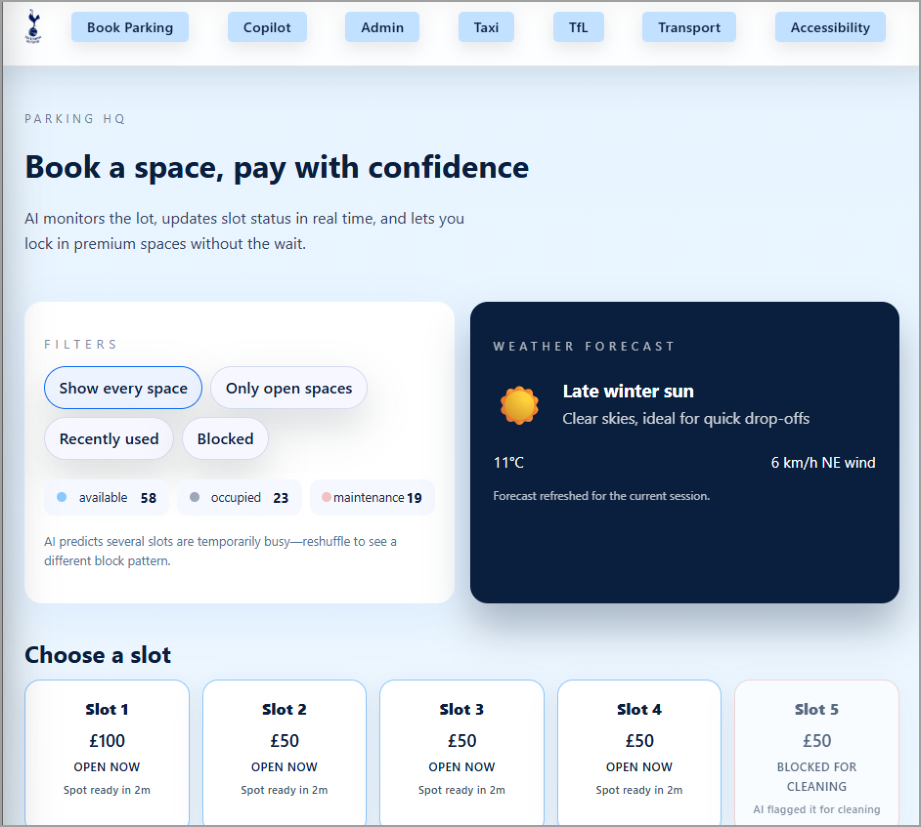


_Figure 27. Parking grid showing available slots and weather_ 

#### **2.2  Filtering Slots** 

Use the filter controls above the grid to narrow down what you can see — available only, occupied only, or reserved only. This is useful during busy matchday periods when scanning the whole grid manually is not practical. Click any green slot to select it. The slot highlights and a payment panel appears below showing the slot number and price. Occupied and reserved slots cannot be clicked. 


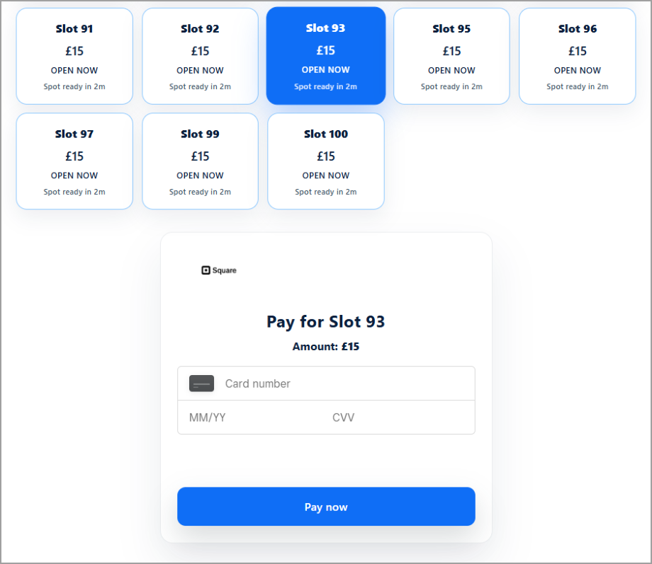


_Figure 28. Parking grid with a slot selected, showing the payment panel below with the slot number and price displayed_ 

#### **2.3 Making a Payment** 

Once a slot is selected, the Square payment form appears below the grid. Card details are entered directly into a Square-hosted iframe — your card number, expiry date, and CVV go to Square's servers and never touch this application at any point. 

- Enter your card number in the card number field. 

- Enter the expiry date in MM/YY format. 

- Enter your CVV. 

- Click Pay now. 

- A success message confirms the booking. The slot turns red in every connected user's grid within around 500 milliseconds. 


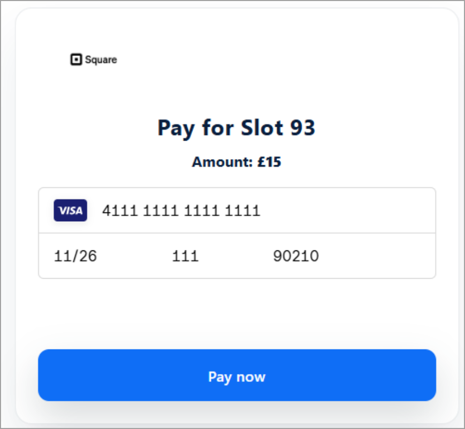


_Figure 29. Square payment form showing the card number, expiry, CVV fields, and the Pay now button_ 

### **SECTION 3  —  Transport and Journey Planning** 

#### **3.1  Live TfL Status** 

Go to /status to see the current status of all TfL lines. Each line has a badge showing its service condition: 

- **Good Service** — running normally with no significant disruption 

- **Minor Delays** — some delays reported, worth adding extra journey time 

- **Severe/Suspended** — significant disruption, check ride options or find an alternative 

Click Show Map to open an interactive Leaflet map centred on White Hart Lane, showing the London Overground route and the stadium marker. 


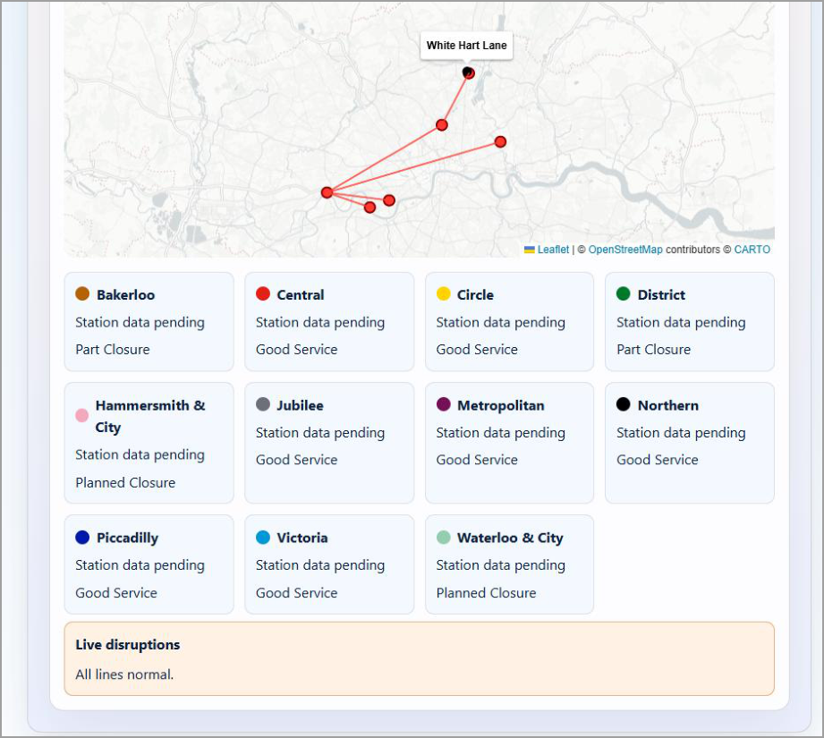


_Figure 30. TfL status dashboard showing line status badges and the expanded Leaflet map with White Hart Lane marked_ 

#### **3.2  Journey Planning** 

Go to /transport for the journey planner. Enter your origin and destination and click Plan Journey to get a recommended route with duration, transfer count, and each leg of the journey broken down. 

- Type your origin station or location in the Origin field. 

- Type your destination in the Destination field. 

- Click Plan Journey. 

- If TfL returns multiple matches for an ambiguous name — for example if you just type "London" — a disambiguation list appears. Pick the correct station from the suggestions. 

- Your route appears with duration, number of transfers, and the individual legs. 

You can also click Add & Go to TfL to open the TfL Journey Planner website with your query already filled in. 


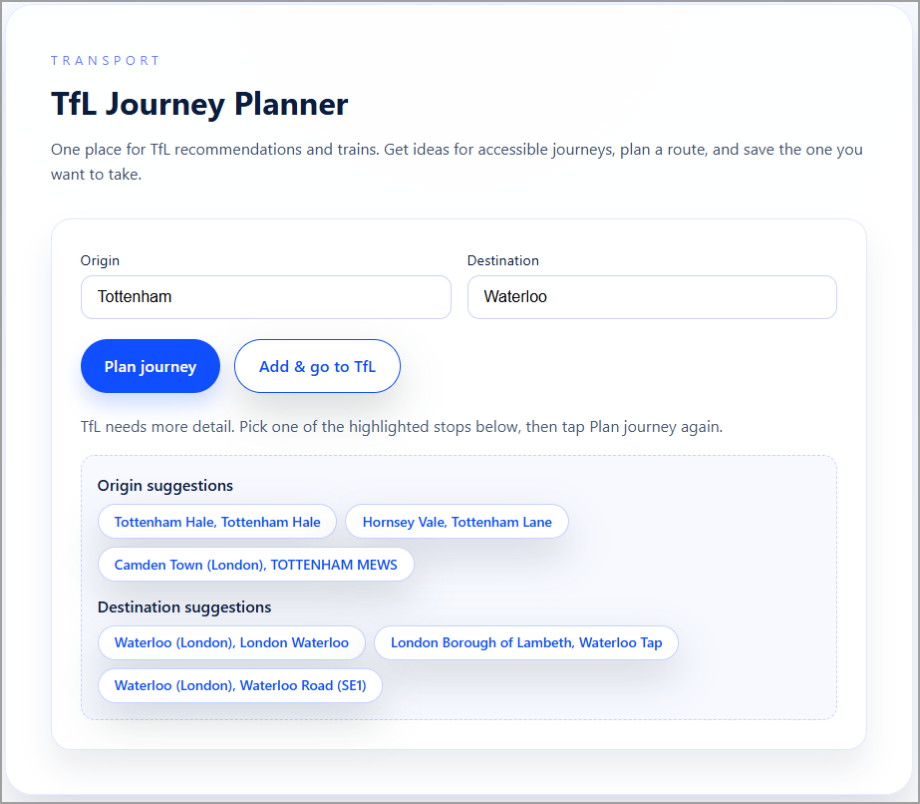


_Figure 31. Journey planner showing the origin and destination fields, Plan Journey button, and a route result with duration and legs_ 

#### **3.3  Live Train Status** 

The /transport page also shows live train service data alongside the journey plan. The train status panel covers the lines serving the stadium area. 

### **SECTION 4  —  Ride Options** 

Go to /rides to see nearby ride options pulled from the Cabwise API. This page is most useful when a TfL disruption makes taxi or private hire a more realistic option. 

The page loads nearby operators automatically. Each card shows the operator name, vehicle type, and estimated availability. If the Cabwise API is not available, clearly labelled fallback cards are shown with an explanatory banner so it is always obvious when live data is not being used. 


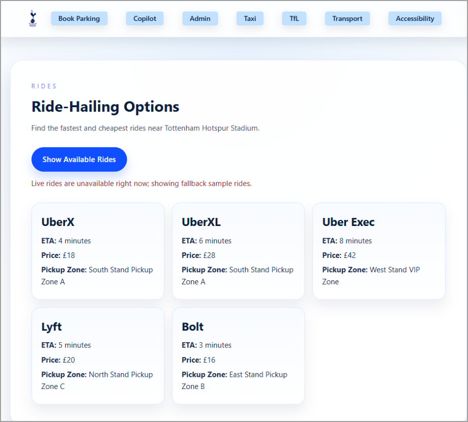


_Figure 32. Ride options page showing operator cards with name, vehicle type, ETA, and price. Fallback banner visible at the top when live data is unavailable_ 

### **SECTION 5  —  Accessibility Controls** 

Go to /accessibility to adjust your preferences. Every setting persists across all pages automatically — you do not need to reconfigure anything when you navigate between screens. 

|**Setting**|**Description**|
|---|---|
|**Font Size (A- / A+)**|Adjusts text size across the entire application between 12px and 28px|
|**High Contrast Mode**|Increases contrast on all interface elements for users with contrast<br>sensitivity|
|**Assistive**<br>**Reading**<br>**Mode**|Enables screen reader optimisations including ARIA labels on interactive<br>elements|


**Reduced Motion** Minimises animations and transitions for users sensitive to movement effects **Step-Free** Passes a step-free routing flag to TfL journey planning to filter for **Preference** accessible routes 


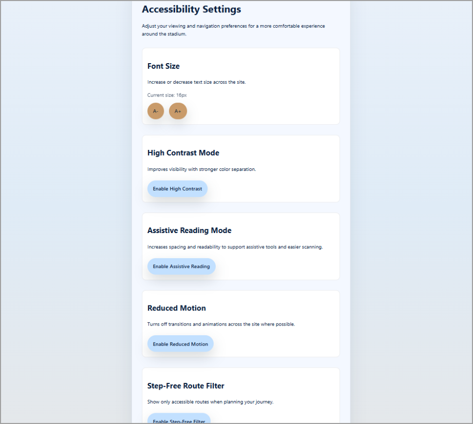


_Figure 33. Accessibility settings page showing font size controls, high contrast toggle, assistive reading mode, reduced motion, and step-free preference_ 

### **SECTION 6  —  Chat Assistant** 

Go to /assistant to use the keyword-driven chat interface. Type a question or click one of the prompt starters and the assistant will point you to the right part of the application with a quick navigation link. 


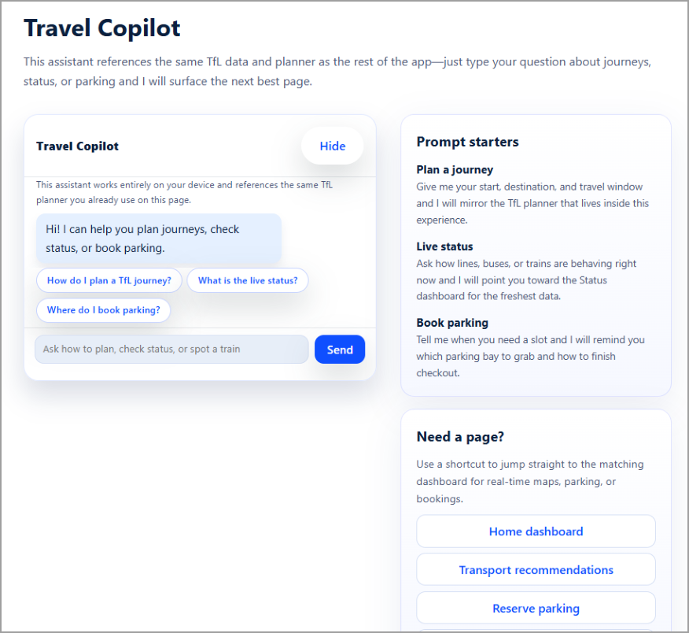


_Figure 34. Chat assistant page showing prompt starters, the chat input field, and navigation shortcut links on the right_ 

### **SECTION 7  —  Admin Dashboard** 

The dashboard shows total registered users, total bookings, total revenue, and parking section occupancy. 

- Recent booking transactions are listed below with the user, slot, amount, and status. 

- Use the Close Section and Open Section controls to manage parking inventory. Enter a section letter and click the relevant button. 

- Enter a registered user's email address in the Promote User field and click Promote to ADMIN. The user will have admin access on their next login. 


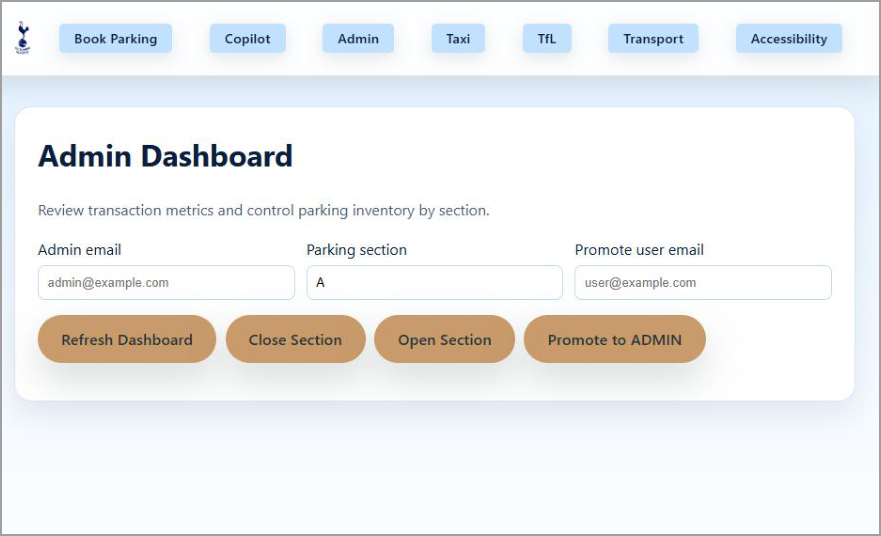


_Figure 35. Admin dashboard showing section open/close controls and the user promotion field_ 


## **Appendix B: Installation Manual** 

This covers the full installation process. Two methods are provided — Docker Compose and manual local setup. Pick one and follow it through. 

### **SECTION 1 —  System Requirements** 

#### **1.1 Hardware Requirements** 

|**Component**|**Minimum Requirement**|
|---|---|
|**CPU**|Dual-core 2 GHz or faster|
|**RAM**|4 GB minimum (8 GB recommended for Docker)|
|**Storage**|2 GB free disk space|
|**Network**|Internet connection required for TfL, Square, and Cabwise APIs|
|**Display**|1024 × 768 minimum resolution|


#### **1.2 Software Requirements** 

|**Software**|**Version**|**Required For**|
|---|---|---|
|**Java (JDK)**|17 (Eclipse Temurin recommended)|Manual setup only|
|**Apache Maven**|3.9 or later|Manual setup only|
|**Node.js + npm**|Node.js 20+ / npm 9+|Manual setup only|
|**PostgreSQL**|16 or later|Manual setup only|
|**Docker Desktop**|Latest stable|Docker method only|
|**Git**|Any recent version|Both methods|


#### **1.3  API Credentials Required** 

|**Credential**|**Where to Obtain**|
|---|---|
|**`SQUARE_ACCESS_TOKEN`**|Square Developer Dashboard (developer.squareup.com) — use<br>Sandbox token|
|**`SQUARE_LOCATION_ID`**|Square Developer Dashboard — Sandbox Locations section|
|**`JWT_SECRET`**|Generate locally: any 256-bit (32-byte) random string|
|**`DB_USER / DB_PASSWORD`**|Set by you — used for the PostgreSQL instance|


### **SECTION 2  —  Method 1: Manual Local Setup** 

**Step 1 — Install Java 17** 

Download Eclipse Temurin 17 from adoptium.net. Run the installer and check it worked: 

```
java -version
# Expected: openjdk version "23" 2024-09-17
OpenJDK Runtime Environment (build 23+37-2369)
OpenJDK 64-Bit Server VM (build 23+37-2369, mixed mode, sharing)
```

#### **Step 2 — Install Apache Maven** 

Download Maven 3.9+ from maven.apache.org/download. Extract it, add the bin folder to your PATH, and check it: 

```
mvn -version
# Expected: Apache Maven 3.9.9
```

**Step 3 — Install Node.js** 

Download Node.js 20 LTS from nodejs.org. npm is included. Check both: 

```
node -v   # Expected: v20.19.4
npm -v    # Expected: 9.2.0
```

#### **Step 4 — Install and Configure PostgreSQL** 

Download PostgreSQL 16 from postgresql.org/download. During installation set a password for the postgres superuser. Then create the database: 

```
psql -U postgres
CREATE DATABASE spurs_db;
CREATE USER spurs_user WITH ENCRYPTED PASSWORD 'your_password';
GRANT ALL PRIVILEGES ON DATABASE spurs_db TO spurs_user;
\q
```


#### **Step 5 — Clone the Repository** 

```
git clone https://gitlab.cim.rhul.ac.uk/zmac461/PROJECT.git
cd PROJECT
```

#### **Step 6 — Start the Backend** 

```
cd FinalProject
mvn spring-boot:run
# Backend starts on http://localhost:8080
```

**Step 7 — Start the Frontend** 

Open a second terminal window: 

```
cd FinalProject/frontend
npm install
cp .env.example .env
# Edit .env and set: VITE_API_BASE_URL=http://localhost:8080
npm run dev
# Frontend starts on http://localhost:5173
```

### **SECTION 3  —  Method 2: Docker Compose** 

Docker Compose handles PostgreSQL, the Spring Boot backend, and the React frontend together with one command. You do not need Java, Maven, Node.js, or PostgreSQL installed locally. 

#### **Step 1 — Install Docker Desktop** 

Download from docker.com and follow the installer for your operating system. Once installed open Docker Desktop and confirm the daemon is running. 

#### **Step 2 — Clone the Repository** 

```
git clone https://gitlab.cim.rhul.ac.uk/zmac461/PROJECT.git
cd PROJECT
```

#### **Step 3 — Build and Start Services** 

```
docker compose up --build
```

This builds the backend JAR, compiles the frontend, and starts all three containers. First run takes 3–5 minutes while Docker pulls base images and Maven downloads dependencies. After that it is much faster. 

#### **Step 4 — Verify the Application is Running** 

Once startup is open: 

**Service URL Frontend** http://localhost:5173 


**Backend API** http://localhost:8080 **Database** localhost:5432 (internal) 

#### **Step 6 — Stop the Application** 

```
docker compose down
# To also remove the database volume (full reset):
docker compose down -v
```

### **SECTION 4  —  Admin Account Setup** 

The admin dashboard needs an account with the ADMIN role, which has to be assigned manually after registration. 

- Register a regular account at http://localhost:5173/register . 

- Connect to PostgreSQL using psql or any database client. 

- Run this query with your registered email: 

```
UPDATE users SET role = 'ADMIN' WHERE email = 'your@email.com';
```

- Log back in and use Season Member ID code 2005 or 2025 to reach the Admin Dashboard. 

### **SECTION 5  —  Running Tests** 

#### **5.1  Backend Tests** 

```
cd FinalProject
mvn test
# 116 tests should pass with BUILD SUCCESS
# JaCoCo report: target/site/jacoco/index.html
# Expected coverage: 98% instruction coverage
```

#### **5.2  Frontend Tests** 

```
cd FinalProject/frontend
npm test
# Or with coverage report:
npm run coverage
# Coverage report: frontend/coverage/index.html
# Expected: 49 tests passing
```


### **SECTION 6  —  Troubleshooting** 

|**Problem**|**Resolution**|
|---|---|
|**Port 8080 already in use**|Stop any other Spring Boot instances. Add server.port=8081 to<br>application.properties if needed.|
|**Database connection refused**|Confirm PostgreSQL is running. Check credentials in<br>application.properties match your local setup.|
|**Square payment fails**|Ensure you are using Sandbox credentials. Production tokens<br>will not work in the sandbox environment.|
|**Docker:**<br>**container**<br>**exits**<br>**immediately**|Check .env file exists in project root. Run: docker compose<br>logs backend|
|**CORS error in browser**|Confirm VITE_API_BASE_URL in frontend .env exactly<br>matches the backend URL including port.|


69 


